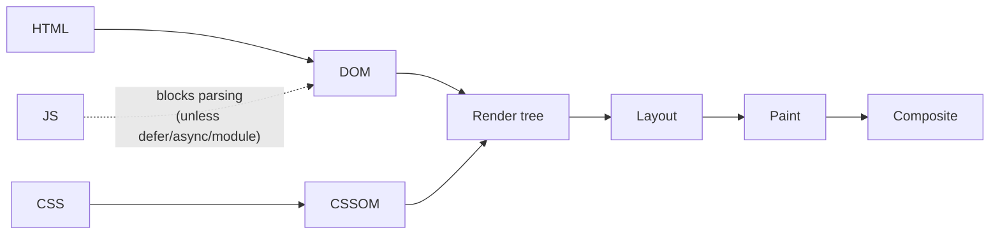

# Performance

Speed is a feature. Slow pages lose users and rank lower in search. Google's **Core Web Vitals** are the shared yardstick.

## Core Web Vitals <span class="lvl lvl-2">Intermediate</span> { #core-web-vitals data-toc-label="Core Web Vitals" }

| Metric | Measures | Good | HTML/CSS levers |
|---|---|---|---|
| **LCP**: Largest Contentful Paint | When the main content (hero image or headline) appears | ≤ 2.5 s | Preload / `fetchpriority="high"` on the hero image, never lazy-load it, inline critical CSS, fast fonts |
| **INP**: Interaction to Next Paint | How quickly the page responds to taps and clicks | ≤ 200 ms | Less JS; native elements (`dialog`, `details`, popover) instead of heavy widgets; `content-visibility` to shrink rendering work |
| **CLS**: Cumulative Layout Shift | How much things jump around while loading | ≤ 0.1 | `width`/`height` on images and iframes, `aspect-ratio`, reserved space for ads/embeds, `font-display` + metric overrides |

Measured at the 75th percentile of real users. Check yours with PageSpeed Insights (field data) and DevTools Performance panel (lab data).

## The critical rendering path <span class="lvl lvl-3">Advanced</span> { #the-critical-rendering-path data-toc-label="The critical rendering path" }



- **CSS is render-blocking**: the browser won't paint until it has the CSS. Keep the critical CSS small; split the rest.
- **Classic `<script>` is parser-blocking**. Use `defer` or `type="module"`.
- Every change to layout properties (`width`, `top`, `font-size`) re-runs Layout → Paint → Composite. Changes to `transform` and `opacity` only re-run Composite.

## HTML wins <span class="lvl lvl-2">Intermediate</span> { #html-wins data-toc-label="HTML wins" }

```html
<!-- Hero image: high priority, no lazy loading, explicit size -->


<!-- Below-the-fold images: lazy -->


<!-- Iframes (maps, videos): lazy -->
<iframe src="…" title="…" loading="lazy" width="560" height="315"></iframe>

<!-- Early connections to critical third-party origins -->
<link rel="preconnect" href="https://cdn.example.com" crossorigin>

<!-- Preload the main web font -->
<link rel="preload" href="/fonts/inter-var.woff2" as="font" type="font/woff2" crossorigin>

<!-- Speculative prefetch/prerender of likely next pages (Chromium) -->
<script type="speculationrules">
  { "prerender": [{ "where": { "href_matches": "/product/*" }, "eagerness": "moderate" }] }
</script>
```

## CSS wins <span class="lvl lvl-3">Advanced</span> { #css-wins data-toc-label="CSS wins" }

```css
/* Skip rendering work for off-screen sections until they're near the viewport */
.section {
  content-visibility: auto;
  contain-intrinsic-size: auto 800px;   /* placeholder height so the scrollbar is stable */
}

/* Isolate a widget so its changes don't trigger page-wide layout */
.widget { contain: layout paint; }

/* Animate only compositor-friendly properties */
.card { transition: transform .2s, opacity .2s; }

/* Reserve space for late-loading content */
.ad-slot { min-height: 250px; }
.embed { aspect-ratio: 16 / 9; }
```

- **Avoid `@import`** in production CSS: each import is a sequential request.
- **Remove unused CSS**: the DevTools **Coverage** tab shows how much of each file is used.
- **Avoid huge DOMs**: over ~1,500 nodes slows style recalculation and layout. Virtualise long lists.
- **Fonts**: WOFF2 only, subset to the characters you need, variable fonts instead of 6 separate weights, `font-display: optional` or `swap` with metric overrides.

## Images <span class="lvl lvl-2">Intermediate</span> { #images data-toc-label="Images" }

| Do | Why |
|---|---|
| AVIF → WebP → JPEG via `<picture>` | AVIF is often ~50% smaller than JPEG |
| `srcset` + `sizes` | Phones don't download desktop-sized images |
| `width` + `height` attributes | Prevents CLS |
| `loading="lazy"` below the fold | Saves bandwidth |
| SVG for icons and logos | Tiny and sharp at any size |
| `<video>` instead of GIF | 5–20× smaller |

## Budgets <span class="lvl lvl-4">Expert</span> { #budgets data-toc-label="Budgets" }

Set limits, then enforce them in CI (Lighthouse CI, `size-limit`, bundlewatch):

| Resource | Example budget (mid-range mobile) |
|---|---|
| Critical CSS (inlined) | ≤ 14 KB compressed (fits in the first TCP round trip) |
| Total CSS | ≤ 60 KB compressed |
| JS on initial load | ≤ 150 KB compressed |
| Hero image | ≤ 150 KB |
| Web fonts | ≤ 2 files, ≤ 100 KB total |
| LCP (lab, Moto G Power, slow 4G) | ≤ 2.5 s |

!!! tip "Senior note · 🔴 Expert"
    The biggest performance wins are usually architectural, not micro-optimisations: ship less JavaScript (server-render, islands, native HTML features), cache aggressively at the CDN with immutable hashed assets, and measure **real users** (RUM via the `web-vitals` library) rather than trusting a fast laptop. Make performance visible: a dashboard of p75 LCP/INP/CLS per page type, reviewed every sprint.
