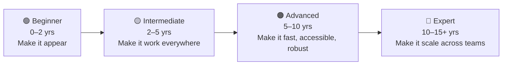

# Learning Roadmap: 0 to 15+ Years

Frontend skill doesn't grow in a straight line. It grows in layers: first you make things appear, then you make them work everywhere, then you make them fast and accessible, then you make it possible for fifty other people to do the same without breaking each other's work.

## 🟢 Beginner (0–2 years): make it appear

**You can:** build a static page from a design, using semantic HTML and a single stylesheet.

- [ ] Write a valid HTML document from memory (`<!doctype html>`, `lang`, `charset`, viewport meta).
- [ ] Choose the right element: `<button>` vs `<a>`, `<ul>` vs `<ol>`, `<section>` vs `
`.
- [ ] Explain the box model and why `box-sizing: border-box` is everyone's default.
- [ ] Use class selectors, descendant and child combinators, `:hover` and `:focus-visible`.
- [ ] Use `rem` for font sizes and know why `px` font sizes hurt accessibility.
- [ ] Build a navbar and a card row with Flexbox.
- [ ] Build a responsive card grid with `repeat(auto-fit, minmax(…))`.
- [ ] Write one mobile-first media query.
- [ ] Build an accessible form: every input has a `<label>`.

**Done looks like:** you can rebuild the [pricing table](../reverse-engineering/recipes.md#pricing-card) and [sticky header](../reverse-engineering/recipes.md#sticky-header) recipes without looking.

## 🟡 Intermediate (2–5 years): make it work everywhere

**You can:** ship production UI that works on every screen size and browser your users have, and debug layout bugs quickly.

- [ ] Explain the cascade in order: origin & importance → context → layers → specificity → order.
- [ ] Debug stacking-context bugs (why `z-index: 9999` "doesn't work").
- [ ] Know when to pick Flexbox vs Grid, and use `grid-template-areas`.
- [ ] Use custom properties for theming, and implement dark mode with `prefers-color-scheme`.
- [ ] Serve responsive images with `srcset`/`sizes` and `<picture>`.
- [ ] Use `<dialog>`, `
`, and the popover API instead of hand-rolled JS widgets.
- [ ] Animate only `transform` and `opacity`, and honour `prefers-reduced-motion`.
- [ ] Use the DevTools Layout, Computed and Rendering panels fluently.

**Done looks like:** you can rebuild the whole [Layout Gallery](../reverse-engineering/gallery.md) from screenshots.

## 🟠 Advanced (5–10 years): make it fast, accessible and robust

**You can:** own the quality of a product's UI: performance budgets, WCAG compliance and resilient CSS.

- [ ] Meet WCAG 2.2 AA: contrast, focus order, focus visibility, target size, reduced motion.
- [ ] Know the first rule of ARIA (don't use ARIA if a native element does the job) and when ARIA is necessary.
- [ ] Diagnose LCP, INP and CLS problems and fix them with HTML/CSS levers (`fetchpriority`, `width`/`height`, `content-visibility`, font loading).
- [ ] Use container queries to build components that adapt to their slot, not the viewport.
- [ ] Use `@layer` to make third-party and utility CSS predictable.
- [ ] Use `:has()` to replace JS-driven state classes.
- [ ] Write progressive enhancement: wrap newer features in `@supports` with a working fallback.

**Done looks like:** you can audit an existing page and produce a prioritised list of accessibility and performance fixes.

## 🔴 Expert (10–15+ years): make it scale across teams

**You can:** set the frontend direction for an organisation. Your decisions let dozens of engineers ship consistent UI without stepping on each other.

- [ ] Design a token system (colour, space, type, radius, motion) and its naming.
- [ ] Choose and justify a CSS architecture (utility-first, CSS Modules, `@layer` + BEM, CSS-in-JS) for a given team and product.
- [ ] Set up linting, visual regression testing and accessibility checks in CI.
- [ ] Plan browser support using Baseline, and roll out new CSS features safely.
- [ ] Review designs for feasibility and accessibility before a line of code is written.
- [ ] Mentor: explain any concept on this site to a beginner in two minutes.

**Done looks like:** you can write the [CSS Architecture](css-architecture.md) page for your own company, and other teams adopt it.

## Time budget

| Level | Hours/week | Focus split |
|---|---|---|
| 🟢 | 8–10 | 40% HTML, 40% CSS, 20% layout |
| 🟡 | 4–6 | 50% layout & responsive, 30% modern CSS, 20% DevTools |
| 🟠 | 3–4 | 40% accessibility, 40% performance, 20% modern CSS |
| 🔴 | 2–3 | Architecture, standards tracking, mentoring |
