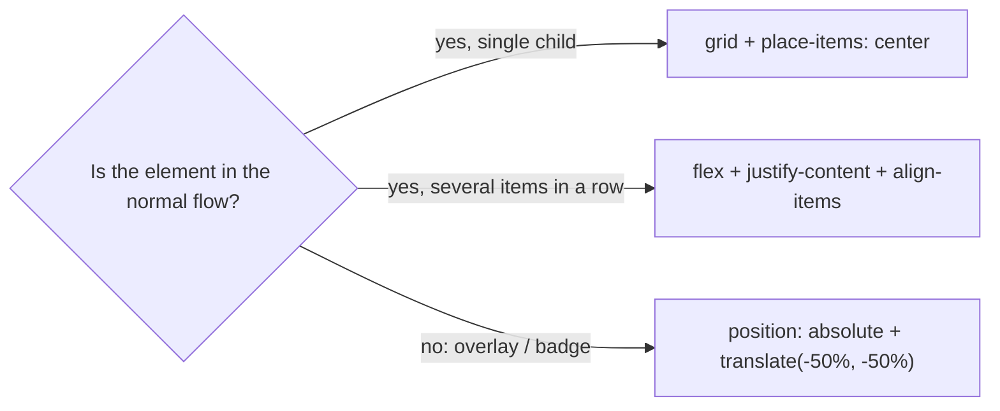

# 1. Center Anything: Three Ways

<span class="level l1">L1</span> ★☆☆ · Grid `place-items`, Flexbox, absolute + `translate`

## Problem

> Center an element horizontally **and** vertically inside a container, three ways, and explain when you would use each.

## Key idea

**Grid** (`display: grid; place-items: center`) is the shortest. **Flexbox** (`justify-content` + `align-items`) is natural when
there are several items in a row. **Absolute positioning** (`inset: 50% auto auto 50%; transform: translate(-50%, -50%)`) takes the
element out of the flow, which is what you want for overlays, badges and spinners on top of other content.



## Solution

```html title="01-centering.html"
--8<-- "./docs/coding-interview/demos/01-centering.html"
```

## Live demo

<iframe src="../demos/01-centering.html" title="Center Anything: Three Ways: live demo" style="width:100%;height:240px;border:1px solid var(--md-default-fg-color--lightest);border-radius:12px" loading="lazy"></iframe>

Open it full-size: [01-centering.html](demos/01-centering.html){ target=_blank }. Resize the window to watch it respond.

## Walkthrough

| Code | Why |
|---|---|
| `.grid { display: grid; place-items: center; }` | `place-items` is shorthand for `align-items` plus `justify-items`. One line, both axes. |
| `.flex { display: flex; justify-content: center; align-items: center; }` | Main axis plus cross axis. Swap them mentally if `flex-direction: column`. |
| `inset: 50% auto auto 50%; transform: translate(-50%, -50%);` | Moves the top-left corner to the centre, then shifts back by half the element's **own** size. No need to know its width. |
| `.box { position: relative; }` | The containing block for the absolutely positioned child. Forgetting it centres the item on the page instead. |
| `check: item centre == box centre (±1.5 px) at 1200 and 375 px` | Verified by measuring `getBoundingClientRect()` in Chromium at two widths. |

## Complexity

| Approach | Time | Space |
|---|---|---|
| layout | O(1) | - |

## Run it

```bash
cd coding-interview && npm test   # runs every check; this problem's report is below
```

```text
--8<-- "coding-interview/outputs/01-centering.txt"
```

## Common mistakes

* `margin: auto` without a width or a flex/grid parent. It centres horizontally only, and only block elements with a width.
* `text-align: center` on a block element. That centres its inline *content*, not the box.
* `top: 50%; left: 50%` without the `translate`, which centres the corner rather than the element.
* `line-height` tricks for vertical centring. They break as soon as the text wraps.

## Follow-up questions

??? question "How do you center a fixed-size modal without JavaScript?"
    Use `<dialog>` (problem 5): the browser centres it with `margin: auto` in the top layer. For a plain element: `position: fixed; inset: 0; margin: auto; width: …; height: fit-content`.

??? question "What does `margin: auto` do in Flexbox and Grid?"
    It absorbs all free space in that direction. `margin-left: auto` on the last nav item pushes it to the far right, and `margin: auto` on a single flex child centres it on both axes.
