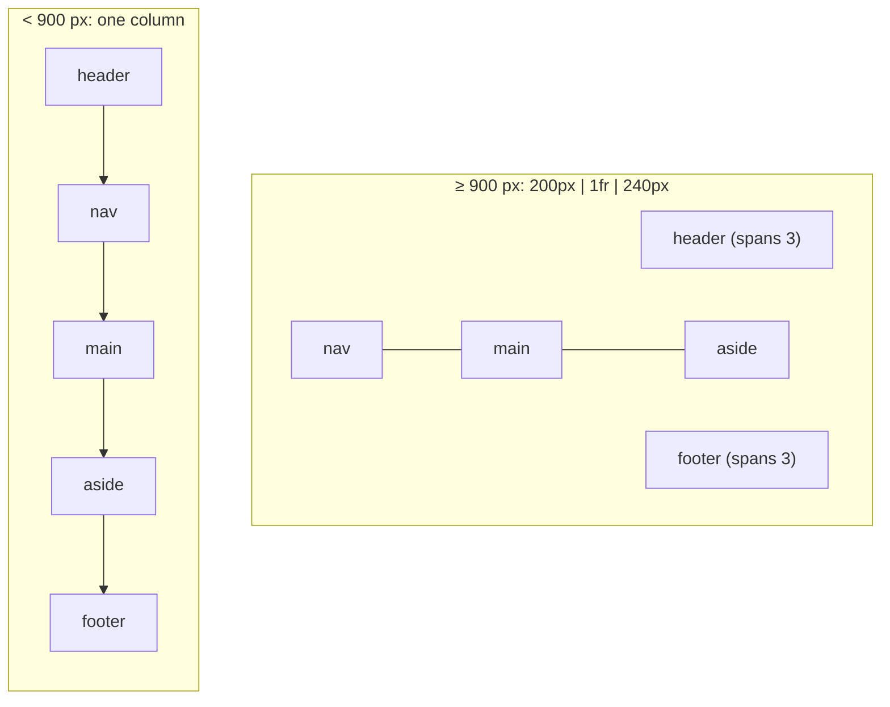

# 2. Holy Grail Layout with Grid Areas

<span class="level l1">L1</span> ★★☆ · `grid-template-areas`, mobile first, `100dvh`, source order

## Problem

> Build a page with a header, footer, left navigation, main content and right sidebar. On desktop the three columns sit side by side and the
> footer stays at the bottom even when the content is short. On mobile everything stacks in reading order.

## Key idea

Name the regions with **`grid-template-areas`**, then redraw the "map" at each breakpoint. The HTML keeps **semantic source order**
(header, nav, main, aside, footer), which is also the mobile and screen-reader order. `min-height: 100dvh` with a `1fr` main row
keeps the footer at the bottom without any `position` tricks.



## Solution

```html title="02-holy-grail.html"
--8<-- "./docs/coding-interview/demos/02-holy-grail.html"
```

## Live demo

<iframe src="../demos/02-holy-grail.html" title="Holy Grail Layout with Grid Areas: live demo" style="width:100%;height:420px;border:1px solid var(--md-default-fg-color--lightest);border-radius:12px" loading="lazy"></iframe>

Open it full-size: [02-holy-grail.html](demos/02-holy-grail.html){ target=_blank }. Resize the window to watch it respond.

## Walkthrough

| Code | Why |
|---|---|
| `grid-template: "header" auto "nav" auto "main" 1fr "aside" auto "footer" auto / 1fr;` | Mobile first: the single-column map *is* the source order. |
| `"header header header" auto "nav main aside" 1fr "footer footer footer" auto / 200px 1fr 240px` | The desktop map. Repeating a name makes an area span columns. The row sizes come before the `/`, the column sizes after. |
| `min-height: 100dvh;` | Dynamic viewport height accounts for mobile browser toolbars appearing and disappearing. `100vh` can overflow on phones. |
| `header { grid-area: header; } ...` | Each element claims its area by name, and the CSS reads like a picture of the layout. |
| `check: footer bottom == viewport bottom (900 px)` | The sticky-footer behaviour is verified, as are the stacked order and full width at 400 px. |

## Complexity

| Approach | Time | Space |
|---|---|---|
| layout | O(1) | - |

## Run it

```bash
cd coding-interview && npm test   # runs every check; this problem's report is below
```

```text
--8<-- "coding-interview/outputs/02-holy-grail.txt"
```

## Common mistakes

* Reordering the DOM for the desktop design, or using `order:`/areas to put content in an illogical place. Keyboard and screen-reader order follow the DOM.
* Fixed pixel heights on main or sidebar. Content overflows on small screens or large fonts.
* Floats and `calc(100% - 440px)` for columns. Grid handles it with `200px 1fr 240px`.
* Forgetting `<nav aria-label=…>` and the landmark elements. They're how screen-reader users jump around the page.

## Follow-up questions

??? question "Grid or Flexbox for page layout?"
    Grid for **two-dimensional** layouts (rows *and* columns aligned together, such as page skeletons and dashboards). Flexbox for **one-dimensional** flows (a toolbar, a row of buttons, centring). They nest happily: the page uses grid, the header uses flex.

??? question "How would you make the sidebar collapsible?"
    Toggle a class on `.page` that changes `grid-template-columns` to `0 1fr 240px` (or redraws the areas), and animate with `transition: grid-template-columns`, which modern browsers support. Keep the toggle a real `<button aria-expanded>`.
