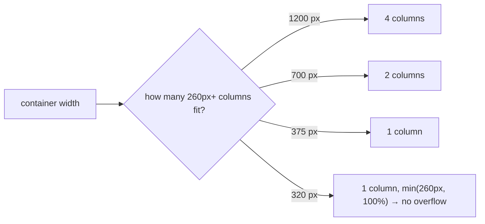

# 3. Responsive Card Grid (No Media Queries)

<span class="level l1">L1</span> ★★☆ · `repeat(auto-fit, minmax())`, `min()`, subgrid-free alignment

## Problem

> Show product cards in as many columns as fit (each at least 260 px), with **no media queries**, **no horizontal scroll** on a 320 px phone,
> and the "Buy" buttons **aligned at the bottom** of every card in a row even when descriptions differ in length.

## Key idea

`grid-template-columns: repeat(auto-fit, minmax(min(260px, 100%), 1fr))` creates as many columns as fit and stretches them to fill
the row. `min(260px, 100%)` stops a 260 px minimum from overflowing a narrower screen. Inside each card, a grid with a `1fr` row for the text
pushes the button to the bottom. Because the grid row stretches every card to the same height, the buttons line up.



## Solution

```html title="03-card-grid.html"
--8<-- "./docs/coding-interview/demos/03-card-grid.html"
```

## Live demo

<iframe src="../demos/03-card-grid.html" title="Responsive Card Grid (No Media Queries): live demo" style="width:100%;height:520px;border:1px solid var(--md-default-fg-color--lightest);border-radius:12px" loading="lazy"></iframe>

Open it full-size: [03-card-grid.html](demos/03-card-grid.html){ target=_blank }. Resize the window to watch it respond.

## Walkthrough

| Code | Why |
|---|---|
| `repeat(auto-fit, minmax(min(260px, 100%), 1fr))` | `auto-fit` collapses empty tracks so the cards stretch. `auto-fill` would keep empty columns, which suits fixed-width cards. |
| `min(260px, 100%)` | A defensive minimum. Without it, a 260 px minimum on a 300 px-wide container with padding forces horizontal scroll. |
| `grid-template-rows: auto auto 1fr auto;` | Image, title, flexible text, then the button. The `1fr` row absorbs the extra height. |
| `aspect-ratio: 16 / 9; object-fit: cover;` | Images reserve their space before loading (no layout shift, good for CLS) and crop instead of stretching. |
| `check: 4 / 2 / 1 columns at 1200 / 700 / 375 px; equal button bottoms; no overflow at 320 px` | Measured in Chromium by grouping the cards' `top` values. |

## Complexity

| Approach | Time | Space |
|---|---|---|
| layout | O(cards) | - |

## Run it

```bash
cd coding-interview && npm test   # runs every check; this problem's report is below
```

```text
--8<-- "coding-interview/outputs/03-card-grid.txt"
```

## Common mistakes

* Media queries for every breakpoint (`@media (min-width: 768px) { grid-template-columns: repeat(2, 1fr) }`), which breaks at sizes nobody tested.
* Flexbox with `flex-wrap` and percentage widths. The last row's cards stretch to odd sizes.
* Fixed card heights to align the buttons. Text overflows as soon as it wraps or the user zooms.
* Images without dimensions or `aspect-ratio`, so the content jumps when they load.

## Follow-up questions

??? question "How would you align titles across cards too, not just buttons?"
    Use **subgrid**: make each card `grid-row: span 4; display: grid; grid-template-rows: subgrid;` inside a parent grid with `grid-auto-rows: auto auto 1fr auto`. Every card then shares the same row tracks, so titles and text blocks align across the row.

??? question "Container queries: when would you use them here?"
    When the card's *own* width should change its layout (image beside the text once the card is wider than 400 px), regardless of the viewport. Set `container-type: inline-size` on the card wrapper and use `@container (min-width: 400px) { … }`.
