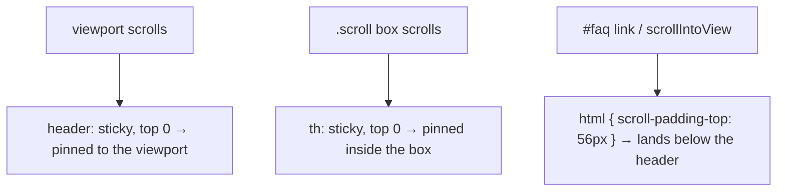

# 4. Sticky Header & Sticky Table Header

<span class="level l1">L1</span> ★★☆ · `position: sticky`, scroll containers, `scroll-padding-top`

## Problem

> Make the site header stay visible while scrolling, make a table's header row stay visible inside its own scrollable box, and make
> in-page anchor links land **below** the sticky header instead of underneath it.

## Key idea

`position: sticky; top: 0` behaves like `relative` until its scroll container scrolls it to `top: 0`, then it sticks. The **nearest
scrolling ancestor** is the reference, so the same declaration on `th` sticks inside `.scroll`, not the page.
`scroll-padding-top` on `html` offsets anchor jumps and `scrollIntoView` by the header's height.



## Solution

```html title="04-sticky-header.html"
--8<-- "./docs/coding-interview/demos/04-sticky-header.html"
```

## Live demo

<iframe src="../demos/04-sticky-header.html" title="Sticky Header & Sticky Table Header: live demo" style="width:100%;height:420px;border:1px solid var(--md-default-fg-color--lightest);border-radius:12px" loading="lazy"></iframe>

Open it full-size: [04-sticky-header.html](demos/04-sticky-header.html){ target=_blank }. Resize the window to watch it respond.

## Walkthrough

| Code | Why |
|---|---|
| `.site-header { position: sticky; top: 0; z-index: 10; }` | `top` is required: sticky does nothing without an offset. `z-index` keeps it above content that scrolls under it. |
| `background: rgb(255 255 255 / .9); backdrop-filter: blur(8px);` | A frosted header: content stays readable as it scrolls underneath. |
| `th { position: sticky; top: 0; }` | Sticky inside `.scroll` because that's the nearest scroll container. `border-collapse: separate` avoids rendering glitches with sticky cells. |
| `html { scroll-padding-top: 56px; }` | Without it, `#faq` scrolls under the header. The check verifies the heading lands below it. |
| `.scroll { tabindex=0 aria-label=… }` | A scrollable region must be focusable so keyboard users can scroll it, and labelled so screen readers announce it. |

## Complexity

| Approach | Time | Space |
|---|---|---|
| scrolling | composited by the browser | - |

## Run it

```bash
cd coding-interview && npm test   # runs every check; this problem's report is below
```

```text
--8<-- "coding-interview/outputs/04-sticky-header.txt"
```

## Common mistakes

* `overflow: hidden` (or `auto`) on an ancestor. That ancestor becomes the scroll container, and sticky silently stops working on the page.
* Forgetting `top: 0`.
* Using `position: fixed` plus a hard-coded `padding-top` on the body. The header leaves the flow and the padding gets out of sync with its height.
* Scroll listeners that toggle classes on every scroll event, which causes jank. Use sticky, or IntersectionObserver for "is it stuck?" styling.

## Follow-up questions

??? question "How do you style the header differently once it's stuck?"
    Put a 1 px sentinel just above the header and observe it with IntersectionObserver. When the sentinel leaves the viewport, add a `.stuck` class (for example to add a shadow). Scroll-driven animations (`animation-timeline: scroll()`) can also do it in pure CSS.

??? question "Why might sticky not work inside a flex or grid parent?"
    If the sticky item stretches to the full height of its parent (the default `align-items: stretch`), there's no room to stick. Give it `align-self: start`.
