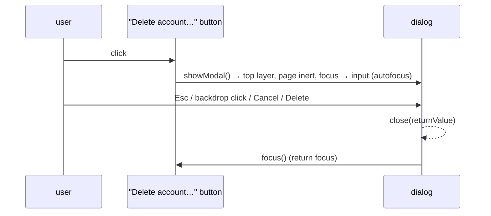

# 5. Accessible Modal Dialog

<span class="level l2">L2</span> ★★☆ · `showModal()`, `::backdrop`, focus management, `method=dialog`

## Problem

> Build a confirmation modal: it blocks the rest of the page, focus moves into it, **Esc** closes it, clicking the backdrop cancels,
> focus **returns** to the button that opened it, and the result (confirmed or cancelled) is reported.

## Key idea

The native **`<dialog>` with `showModal()`** does the hard parts. It renders in the **top layer** (no z-index wars), makes the rest
of the page **inert** (no focus or clicks outside), closes on **Esc**, and supports **`autofocus`**. A form with `method="dialog"` closes
it and puts the clicked button's `value` in `dialog.returnValue`. You add backdrop-click handling and **returning focus** to the opener.



## Solution

```html title="05-modal-dialog.html"
--8<-- "./docs/coding-interview/demos/05-modal-dialog.html"
```

## Live demo

<iframe src="../demos/05-modal-dialog.html" title="Accessible Modal Dialog: live demo" style="width:100%;height:320px;border:1px solid var(--md-default-fg-color--lightest);border-radius:12px" loading="lazy"></iframe>

Open it full-size: [05-modal-dialog.html](demos/05-modal-dialog.html){ target=_blank }. Resize the window to watch it respond.

## Walkthrough

| Code | Why |
|---|---|
| `dialog.showModal()` | Not `show()`, which opens a non-modal dialog without inertness or a backdrop. |
| `<dialog aria-labelledby="confirm-title" aria-describedby="confirm-desc">` | Screen readers announce the title and description when it opens. |
| `<form method="dialog"> … <button value="delete">` | Submitting closes the dialog and sets `returnValue`. No `preventDefault` and no manual `close()`. `formnovalidate` on Cancel skips validation. |
| `if (e.target === dialog) dialog.close("cancel")` | Clicks on the `::backdrop` are dispatched to the dialog element itself. Clicks inside hit the form or its children. |
| `opener.focus()` | Returning focus is part of the pattern. Otherwise keyboard users are dropped at the top of the document. |
| `check: page.waitForFunction(result !== "")` | The `close` event fires asynchronously. The first version of the check read the result too early and was flaky, so it now waits. |

## Complexity

| Approach | Time | Space |
|---|---|---|
| open / close | O(1) | - |

## Run it

```bash
cd coding-interview && npm test   # runs every check; this problem's report is below
```

```text
--8<-- "coding-interview/outputs/05-modal-dialog.txt"
```

## Common mistakes

* Building a modal from `<div>`s, which means hand-writing the focus trap, inertness, Esc handling, ARIA roles and z-index.
* Not returning focus to the opener on close.
* Animating with `display` changes that remove the closing animation, or ignoring `prefers-reduced-motion`.
* Putting critical content only in the modal for mobile users, where small viewports clip it. Use `width: min(420px, 100% - 32px)` and let the content scroll.

## Follow-up questions

??? question "How do you prevent the page behind from scrolling?"
    Modern CSS: `body:has(dialog[open]) { overflow: hidden; }`. Watch for layout shift as the scrollbar disappears. `scrollbar-gutter: stable` on `html` reserves its space.

??? question "Dialog vs the Popover API?"
    `<dialog>` with `showModal()` is for **modal** interactions that must be answered. The **popover** attribute (`popover`, `popovertarget`) is for **non-modal** overlays such as menus and tooltips that light-dismiss. It's also in the top layer, but it doesn't make the page inert.
