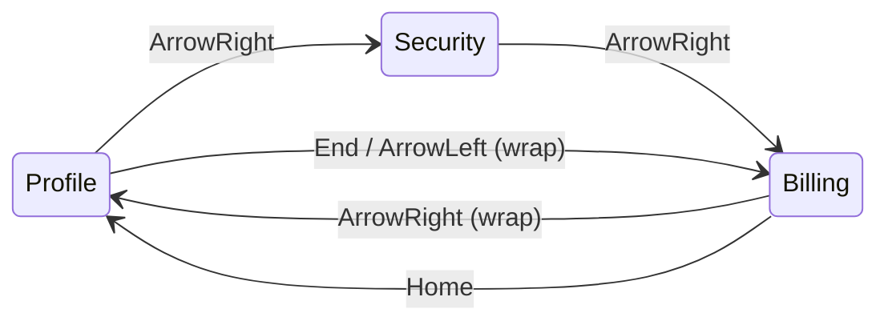

# 6. Accessible Tabs (Roving Tabindex)

<span class="level l2">L2</span> ★★★ · WAI-ARIA tabs pattern, `aria-selected`, arrow / Home / End keys

## Problem

> Build tabs that work with a mouse **and** keyboard and screen readers. The tab list is **one** Tab stop, arrow keys move between tabs
> (wrapping around), Home and End jump to the ends, and only the selected panel is visible.

## Key idea

Follow the **WAI-ARIA tabs pattern**: `role="tablist"`, `role="tab"` with `aria-selected` and `aria-controls`, and `role="tabpanel"` with
`aria-labelledby`. Use a **roving tabindex**: the selected tab has `tabindex="0"` and the others `-1`, so Tab enters the list once and
the next Tab goes to the panel. Arrow keys change the selection and move focus.



## Solution

```html title="06-tabs.html"
--8<-- "./docs/coding-interview/demos/06-tabs.html"
```

## Live demo

<iframe src="../demos/06-tabs.html" title="Accessible Tabs (Roving Tabindex): live demo" style="width:100%;height:220px;border:1px solid var(--md-default-fg-color--lightest);border-radius:12px" loading="lazy"></iframe>

Open it full-size: [06-tabs.html](demos/06-tabs.html){ target=_blank }. Resize the window to watch it respond.

## Walkthrough

| Code | Why |
|---|---|
| `<button role="tab" aria-controls="panel-security" aria-selected="false" tabindex="-1">` | Real buttons are focusable and clickable. `tabindex=-1` removes the inactive tabs from the Tab order. |
| `t.tabIndex = on ? 0 : -1` | The roving tabindex. The check confirms that exactly one tab has `tabindex=0` after any number of key presses. |
| `{ ArrowRight: i + 1, ArrowLeft: i - 1, Home: 0, End: tabs.length - 1 }[e.key]` | A lookup table instead of a `switch`, with modulo for wrap-around. |
| `e.preventDefault()` | Stops Home and End from scrolling the page. |
| `role="tabpanel" tabindex="0"` | Makes the panel itself focusable, so the next Tab after the tab list lands on the content. The check asserts this order. |

## Complexity

| Approach | Time | Space |
|---|---|---|
| key press | O(tabs) | - |

## Run it

```bash
cd coding-interview && npm test   # runs every check; this problem's report is below
```

```text
--8<-- "coding-interview/outputs/06-tabs.txt"
```

## Common mistakes

* Every tab in the Tab order. Keyboard users then press Tab several times just to get past the tabs.
* Using `<div>`s with click handlers and no keyboard support or roles.
* Hiding panels with `opacity: 0`. They stay focusable and readable. Use `hidden`.
* Forgetting `aria-selected`, so screen readers can't tell which tab is active.

## Follow-up questions

??? question "Automatic vs manual activation?"
    **Automatic** (this solution): arrow keys move focus *and* select. That's good when panels render instantly. **Manual**: arrows move focus only, and Enter or Space selects. Use it when showing a panel is expensive, for example when it fetches data.

??? question "When should tabs be links instead?"
    When each "tab" is really a separate page or URL (site sections). Then use a `<nav>` with links and `aria-current="page"`, not the tabs pattern.
