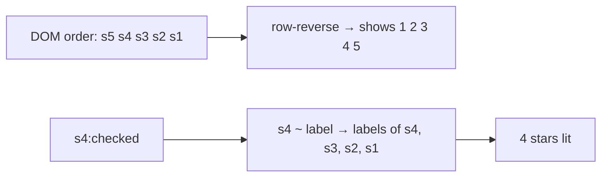

# 7. Star Rating with Zero JavaScript

<span class="level l2">L2</span> ★★☆ · Radio inputs, `row-reverse` + `~`, visually-hidden pattern, `content: "★" / ""`

## Problem

> Build a 5-star rating input. Hovering previews the rating, clicking sets it, it works with the **keyboard** and **screen readers**, it
> submits with a form, and it uses **no JavaScript**.

## Key idea

Use **radio inputs** for the semantics: keyboard arrows, form value and screen-reader names all come for free. CSS can only select
**later** siblings (`~`), so put the stars in DOM order 5→1 and display them with **`flex-direction: row-reverse`**. "Checked and all
stars below it" then becomes `input:checked ~ label`. Hide the inputs **visually** (the clip pattern), never with `display: none`, `hidden` or a
full-size `opacity: 0`.



## Solution

```html title="07-star-rating.html"
--8<-- "./docs/coding-interview/demos/07-star-rating.html"
```

## Live demo

<iframe src="../demos/07-star-rating.html" title="Star Rating with Zero JavaScript: live demo" style="width:100%;height:160px;border:1px solid var(--md-default-fg-color--lightest);border-radius:12px" loading="lazy"></iframe>

Open it full-size: [07-star-rating.html](demos/07-star-rating.html){ target=_blank }. Resize the window to watch it respond.

## Walkthrough

| Code | Why |
|---|---|
| `.rating { flex-direction: row-reverse; }` | Visual order is reversed, so the sibling combinator selects the stars to the *left* of the checked one. |
| `.rating input:checked ~ label { color: #f59e0b; }` | The checked star and every later sibling (the lower ratings) light up. The check counts exactly 4 amber stars after clicking the 4th. |
| `.rating input { width: 1px; height: 1px; clip-path: inset(50%); }` | **Bug found by the checks:** the first draft used `opacity: 0` at full size, and the five invisible inputs stacked over the first star and intercepted clicks. Clipping keeps them focusable without taking space. |
| `<span class="sr-only">4 stars</span>` | **Bug found by the checks:** the first draft used `<span hidden>`, which hides the text from screen readers too, so the radios had no names. The check asserts `getByRole('radio', { name: '4 stars' })`. |
| `content: "★" / "";` | Alternative text for generated content. The decorative star isn't read aloud as "black star". |

## Complexity

| Approach | Time | Space |
|---|---|---|
| interaction | O(1), pure CSS | - |

## Run it

```bash
cd coding-interview && npm test   # runs every check; this problem's report is below
```

```text
--8<-- "coding-interview/outputs/07-star-rating.txt"
```

## Common mistakes

* `display: none` on the inputs, which removes them from the keyboard and accessibility tree. The rating becomes mouse-only.
* Building it from `<span>`s with click handlers: no keyboard support, no form value, no semantics.
* Forgetting a group label (`<fieldset>` + `<legend>`), so screen readers don't know what the stars rate.
* Hover-only previews with no focus styling for keyboard users (`:focus-visible + label`).

## Follow-up questions

??? question "How would you support half stars?"
    Use ten radio inputs (0.5 steps) whose labels each cover half a star (`clip-path` or a half-width `::before`), or use a native `<input type="range" step="0.5">` styled as stars. The range input announces its value and supports arrow keys.

??? question "How do you show a read-only average like 3.7?"
    Don't use inputs. Render the text `3.7 out of 5` for assistive technology and draw the stars with a background gradient or mask whose width is `calc(3.7 / 5 * 100%)`.
