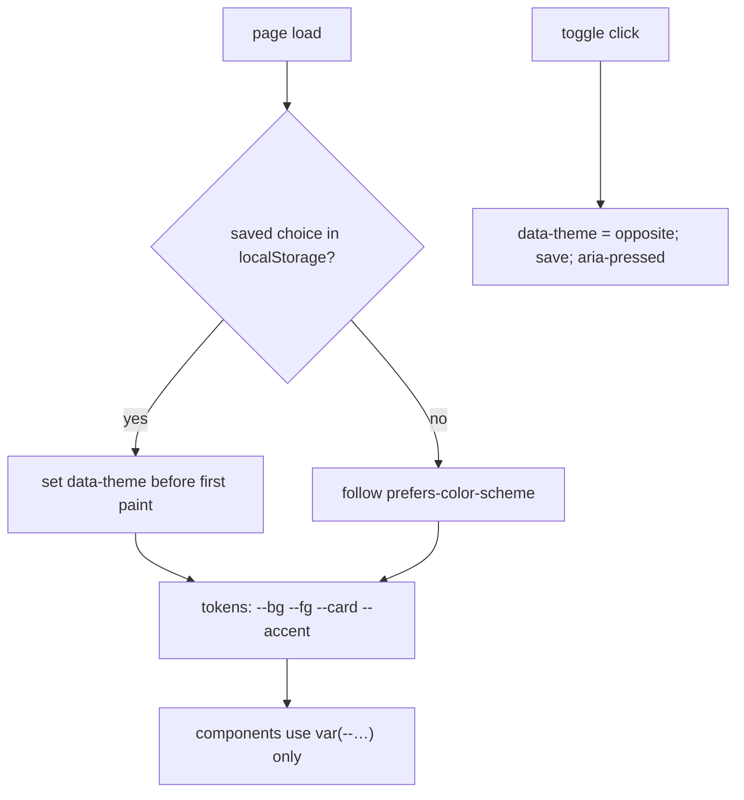

# 8. Dark Mode with Custom Properties

<span class="level l2">L2</span> ★★☆ · Design tokens, `prefers-color-scheme`, `data-theme` override, no flash

## Problem

> Support light and dark themes. Follow the **OS setting** by default, let the user **override** it with a toggle, **remember** the choice,
> and avoid a flash of the wrong theme on load. Components must not contain colour values.

## Key idea

Components use **tokens only** (`var(--bg)`, `var(--fg)`). A theme is just a different set of token values: light on `:root`, dark
inside `@media (prefers-color-scheme: dark)` **unless** the user forced light, and dark again under `[data-theme="dark"]`. A tiny inline
script in `<head>` applies the saved choice **before first paint**. Setting `color-scheme` makes form controls and scrollbars match too.



## Solution

```html title="08-theme-toggle.html"
--8<-- "./docs/coding-interview/demos/08-theme-toggle.html"
```

## Live demo

<iframe src="../demos/08-theme-toggle.html" title="Dark Mode with Custom Properties: live demo" style="width:100%;height:220px;border:1px solid var(--md-default-fg-color--lightest);border-radius:12px" loading="lazy"></iframe>

Open it full-size: [08-theme-toggle.html](demos/08-theme-toggle.html){ target=_blank }. Resize the window to watch it respond.

## Walkthrough

| Code | Why |
|---|---|
| `@media (prefers-color-scheme: dark) { :root:not([data-theme="light"]) { … } }` | Dark by OS preference, unless the user explicitly chose light. |
| `:root[data-theme="dark"] { … }` | Dark by explicit choice, even when the OS is light. |
| `<script> try { … localStorage.getItem("theme") … } catch (e) {} </script> in <head>` | Runs before the body renders, so there's no flash. `try` covers private modes where storage throws. |
| `color-scheme: dark;` | The browser also darkens native UI: scrollbars, form controls, `<dialog>` backgrounds. |
| `check: assert on --bg, not body background` | **Lesson from the checks:** `body` has a 0.2 s colour transition, so `getComputedStyle(body).backgroundColor` read just after the click was still dark. The token isn't transitioned, so assert on it. |

## Complexity

| Approach | Time | Space |
|---|---|---|
| theme switch | one attribute change; the browser restyles | - |

## Run it

```bash
cd coding-interview && npm test   # runs every check; this problem's report is below
```

```text
--8<-- "coding-interview/outputs/08-theme-toggle.txt"
```

## Common mistakes

* Hard-coded colours in components (`color: #333`). Every component then needs a dark override.
* Applying the saved theme in a script at the end of `<body>`, which flashes light, then dark.
* A toggle with only two states that ignores the OS. Users who change the OS theme at night expect the site to follow unless they chose otherwise.
* Forgetting `aria-pressed` (or a clear label) on the toggle.

## Follow-up questions

??? question "How would you offer light, dark and system?"
    Use a three-option control (radio group or select). "System" removes `data-theme` and the saved value, so the media query takes over again. Listen to `matchMedia('(prefers-color-scheme: dark)').onchange` only if JavaScript needs to know the theme.

??? question "What about the new light-dark() function?"
    `color: light-dark(#0f172a, #e2e8f0)` picks a value based on the element's `color-scheme`. Combined with `color-scheme: light dark` on `:root` (and `color-scheme: dark` for a forced theme), it removes most media-query duplication.
