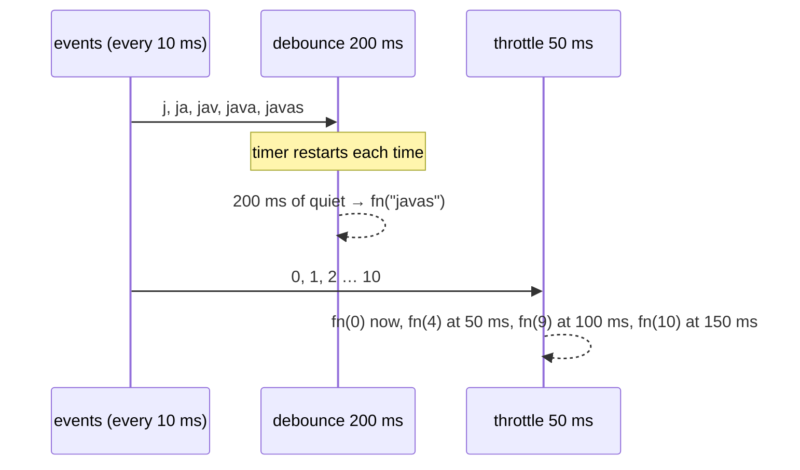

# 9. Debounce & Throttle from Scratch

<span class="level l2">L2</span> ★★☆ · Timers, closures, `this`, leading/trailing edges, mock timers

## Problem

> Implement `debounce(fn, wait, { leading, trailing })` and `throttle(fn, wait)`. Preserve `this` and the latest arguments, and provide `cancel()`.
> Test them **without waiting in real time**.

## Key idea

**Debounce** restarts a timer on every call and runs only when calls **stop** for `wait` ms (search boxes, resize end). **Throttle** runs
at most once per `wait` ms **while** calls keep coming: immediately, then the latest pending call at the end of each window (scroll,
mousemove). Both are closures over timer state. Node's `mock.timers` (with `Date`) makes the tests instant and exact.



## Solution

```javascript title="debounce-throttle.mjs"
--8<-- "./coding-interview/js/debounce-throttle.mjs"
```

## Walkthrough

| Code | Why |
|---|---|
| `clearTimeout(timer); timer = setTimeout(() => { … fn.apply(lastThis, lastArgs) }, wait)` | The core of debounce: each call cancels the pending run, and only the last one survives. |
| `lastArgs = args; lastThis = this;` | The trailing call uses the **latest** arguments and the correct `this`, so it works as an object method (`obj.inc`). |
| `const callNow = leading && timer === null;` | Leading edge: fire on the first call of a burst, and don't fire again at the end unless more calls came in. |
| `const remaining = wait - (now - last); if (remaining <= 0) { …call now… } else { …schedule trailing… }` | Throttle: call immediately when the window has passed, otherwise remember the latest arguments and schedule one trailing call. |
| `assert.deepEqual(calls, [0, 4, 9, 10])` | **Lesson from the checks:** the first expectation (`[0, 5, 10]`) was wrong. Throttle's trailing call carries the *latest* arguments in each window. The check also asserts at most one call per 50 ms. |

## Complexity

| Approach | Time | Space |
|---|---|---|
| each call | O(1) | O(1) |

## Run it

```bash
cd coding-interview && npm test   # runs every check; this problem's report is below
```

```text
--8<-- "coding-interview/outputs/09-debounce-throttle.txt"
```

## Common mistakes

* Using arrow functions for the returned wrapper, so `this` is lost when it's used as a method.
* Calling `fn(...args)` from the first call instead of the latest one on the trailing edge, which searches for "j" instead of "javas".
* Creating a new debounced function on every render (React) so the timer never accumulates. Memoise it with `useMemo`/`useRef`.
* Testing with real `setTimeout` and arbitrary sleeps, which gives slow, flaky tests.

## Follow-up questions

??? question "Which would you use for a search box, window resize and infinite scroll?"
    Search box: **debounce** (about 300 ms), plus cancelling stale requests (`AbortController`). Resize: **debounce** for expensive recalculation, or `ResizeObserver`. Scroll position: **throttle** or `requestAnimationFrame`. Infinite scroll: neither, use **IntersectionObserver** (problem 12).

??? question "How would you add a maxWait to debounce?"
    Track when the first call of the burst happened. If `now - firstCall >= maxWait`, run immediately even though calls continue. That's lodash's `maxWait`, and it turns debounce into a guaranteed-progress throttle.
