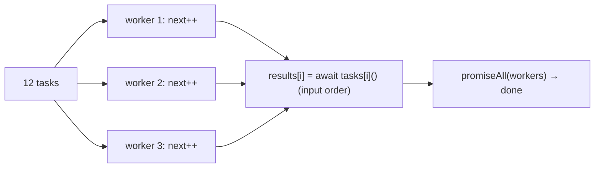

# 10. Promise.all, allSettled & a Concurrency Pool

<span class="level l2">L2</span> ★★☆ · Promise construction, input order, first rejection, async worker pool

## Problem

> Implement `promiseAll` and `promiseAllSettled` without the built-ins, and a `pool(tasks, limit)` that runs async tasks with at most
> `limit` in flight, returning results in input order.

## Key idea

`all` creates **one** outer promise, subscribes to every input (wrapped in `Promise.resolve` so plain values and thenables work),
stores each result **at its index**, and resolves when the countdown reaches zero, or rejects on the **first** rejection.
`allSettled` maps every input to an outcome object, then reuses `all`. A pool starts `limit` **workers** that each pull the next index
from a shared counter until the list is exhausted.



## Solution

```javascript title="promise-utils.mjs"
--8<-- "./coding-interview/js/promise-utils.mjs"
```

## Walkthrough

| Code | Why |
|---|---|
| `Promise.resolve(item).then((value) => { results[i] = value; if (--remaining === 0) resolve(results); }, reject)` | Index-based storage keeps **input order** even though completion order differs. Rejecting on the first failure matches the spec. |
| `if (remaining === 0) return resolve(results);` | `all([])` must resolve immediately, a classic edge case. |
| `(value) => ({ status: "fulfilled", value }), (reason) => ({ status: "rejected", reason })` | `allSettled` never rejects. Every input becomes a descriptive object, with the same shape as the built-in, and the check compares against it. |
| `const i = next++; results[i] = await tasks[i]();` | Safe without locks: JavaScript runs one piece of code at a time, and `await` is the only point where another worker can run. |
| `Array.from({ length: Math.min(limit, tasks.length) }, worker)` | Exactly `limit` workers. The check measures the maximum concurrency as 3. |

## Complexity

| Approach | Time | Space |
|---|---|---|
| promiseAll | O(n) | O(n) |
| pool | O(n) tasks, ≤ limit concurrent | O(n) results |

## Run it

```bash
cd coding-interview && npm test   # runs every check; this problem's report is below
```

```text
--8<-- "coding-interview/outputs/10-promise-utils.txt"
```

## Common mistakes

* Pushing results with `results.push(value)`, which gives completion order instead of input order.
* Forgetting that inputs can be plain values, not only promises.
* A "pool" that starts every task at once with `tasks.map(t => t())` and only *awaits* them in batches. The concurrency isn't actually limited.
* `promiseAll` that keeps running other work after a rejection and leaks errors as unhandled rejections. (The other promises still run; `all` just stops listening. Use `AbortController` to really cancel.)

## Follow-up questions

??? question "Implement Promise.race and Promise.any."
    `race`: resolve or reject with the first settled input (`items.forEach(p => Promise.resolve(p).then(resolve, reject))`). `any`: resolve with the first *fulfilled* input. Reject only when **all** inputs reject, with an `AggregateError` of the reasons, counting down rejections the way `all` counts fulfilments.

??? question "How do you add a timeout to a promise?"
    `Promise.race([p, new Promise((_, rej) => setTimeout(() => rej(new Error('timeout')), ms))])`. For `fetch`, prefer `AbortSignal.timeout(ms)`, which actually cancels the request instead of just ignoring it.
