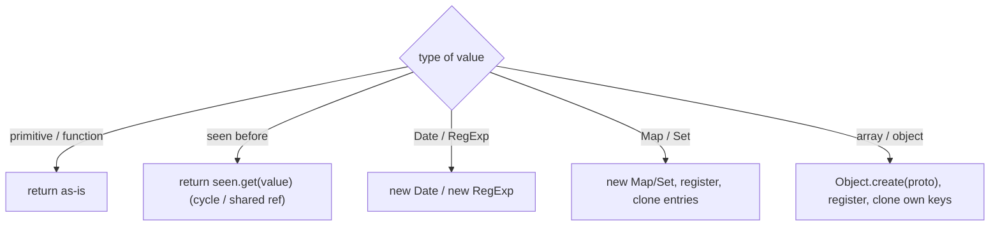

# 11. deepClone & deepEqual (Cycles, Map, Set, Date)

<span class="level l3">L3</span> ★★★ · Recursion, `WeakMap` for cycles, prototypes, `Reflect.ownKeys`, `Object.is`

## Problem

> Write `deepClone(value)` that copies nested objects and arrays plus `Date`, `RegExp`, `Map`, `Set` and symbol keys, keeps class
> prototypes, and survives **cycles** and **shared references**. Write a matching `deepEqual`.

## Key idea

Recurse by type, and keep a **`WeakMap` from original to copy**. Register the copy **before** recursing, so a cycle finds the
half-built copy instead of looping forever, and shared references stay shared. Copy with `Object.create(prototype)` and
`Reflect.ownKeys` (string and symbol keys). `deepEqual` mirrors the structure, with `Object.is` for primitives (NaN equals NaN) and a
`WeakMap` of pairs already being compared, again for cycles.



## Solution

```javascript title="deep-clone.mjs"
--8<-- "./coding-interview/js/deep-clone.mjs"
```

## Walkthrough

| Code | Why |
|---|---|
| `if (seen.has(value)) return seen.get(value);` | Cycles (`a.self = a`) and shared references (`left === right`) map to the same copy. The check asserts `c.self === c` and `c.left === c.right`. |
| `seen.set(value, copy);  // register BEFORE recursing` | If you register after recursing, a cycle recurses forever. |
| `Object.create(Object.getPrototypeOf(value))` | Class instances keep their methods. The check calls `deepClone(new Money(1250)).format()`. |
| `for (const key of Reflect.ownKeys(value))` | Includes symbol keys, which `Object.keys` and `for…in` skip. |
| `if (Object.is(a, b)) return true;` | `NaN` equals `NaN` (unlike `===`), and `+0` and `-0` are distinct. |
| `!deepEqual({ a: 1 }, { a: 1, b: undefined })` | Key sets must match. A missing key isn't the same as an `undefined` value. |

## Complexity

| Approach | Time | Space |
|---|---|---|
| deepClone / deepEqual | O(nodes) | O(nodes) for the WeakMap + recursion depth |

## Run it

```bash
cd coding-interview && npm test   # runs every check; this problem's report is below
```

```text
--8<-- "coding-interview/outputs/11-deep-clone.txt"
```

## Common mistakes

* `JSON.parse(JSON.stringify(x))`. It loses `Date` (becomes a string), `Map`/`Set` (become `{}`), `undefined`, functions and prototypes, and throws on cycles.
* Registering the copy in `seen` after recursing, which gives infinite recursion on cycles.
* `for…in` without `hasOwnProperty`, which copies inherited enumerable properties onto the clone.
* Comparing `typeof a === 'object'` without excluding `null`.

## Follow-up questions

??? question "What about structuredClone?"
    `structuredClone(value)` is built in and handles cycles, `Date`, `Map`, `Set`, typed arrays and more. It **doesn't** keep prototypes (class instances become plain objects), and it throws on functions and DOM nodes. In interviews, mention it first, then write your own to show you understand the algorithm.

??? question "How would you avoid stack overflow on very deep structures?"
    Replace recursion with an explicit stack of `[source, target, key]` work items. Iterate, creating containers and pushing their children, so the depth is limited by heap memory rather than the call stack.
