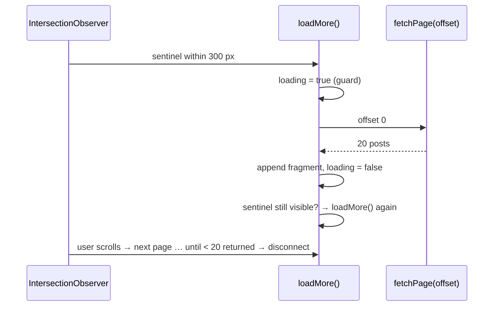

# 12. Infinite Scroll with IntersectionObserver

<span class="level l2">L2</span> ★★★ · Sentinel + `rootMargin`, in-flight guard, `DocumentFragment`, end of feed

## Problem

> Load posts 20 at a time as the user scrolls, starting before they reach the bottom. Never fire two requests at once, stop at the end
> (75 posts), announce progress to screen readers, and avoid scroll listeners.

## Key idea

Put an empty **sentinel** after the list and observe it with **`IntersectionObserver`** using `rootMargin: "300px"`, so loading starts
300 px before it scrolls into view. A **`loading` flag** stops duplicate requests, a `DocumentFragment` appends a page in one reflow,
and the observer disconnects at the end. Because the observer only fires on **changes**, check again after each load in case the
sentinel is *still* visible (tall screens).



## Solution

```html title="12-infinite-scroll.html"
--8<-- "./docs/coding-interview/demos/12-infinite-scroll.html"
```

## Live demo

<iframe src="../demos/12-infinite-scroll.html" title="Infinite Scroll with IntersectionObserver: live demo" style="width:100%;height:420px;border:1px solid var(--md-default-fg-color--lightest);border-radius:12px" loading="lazy"></iframe>

Open it full-size: [12-infinite-scroll.html](demos/12-infinite-scroll.html){ target=_blank }. Resize the window to watch it respond.

## Walkthrough

| Code | Why |
|---|---|
| `new IntersectionObserver(cb, { rootMargin: "300px" })` | The browser computes visibility off the main thread. No `scroll` listener, no `getBoundingClientRect` on every scroll event. |
| `if (loading \|\| done) return;` | The observer can fire again while a request is in flight. Without the guard you get duplicate pages. The check asserts 75 *unique* posts. |
| `const frag = document.createDocumentFragment(); … feed.append(frag);` | One DOM insertion per page instead of 20, so a single layout. |
| `if (sentinel.getBoundingClientRect().top < innerHeight + 300) loadMore();` | **Bug found by the checks:** on a 4000 px-tall screen the sentinel never left the viewport, so the observer never fired again and the feed stalled at 20. This re-check fixes it. |
| `<p id="status" role="status">` | A live region: "40 posts loaded" and "All 75 posts loaded" are announced to screen-reader users. |

## Complexity

| Approach | Time | Space |
|---|---|---|
| per page | O(page size) DOM work | O(items rendered) |

## Run it

```bash
cd coding-interview && npm test   # runs every check; this problem's report is below
```

```text
--8<-- "coding-interview/outputs/12-infinite-scroll.txt"
```

## Common mistakes

* `window.addEventListener('scroll', …)` measuring positions on every event, which causes jank and layout thrashing.
* No in-flight guard, so the same page loads several times.
* Never stopping, which fires empty requests forever at the end of the feed.
* Keeping 10,000 DOM nodes. For very long feeds, **virtualise** (render only the visible window) and keep a "Load more" button as a fallback.

## Follow-up questions

??? question "How do you keep the footer reachable and the back button working?"
    Offer a "Load more" button instead of auto-loading after a few pages, or put the footer content elsewhere. Store the loaded page in the URL (`?page=3`) or `history.state`, and restore the scroll position on back navigation.

??? question "Cursor or offset pagination for the API?"
    Use a **cursor** (opaque `next` token from the last item). New posts inserted at the top then don't shift pages and cause duplicates or gaps, and deep pages stay fast on the database.
