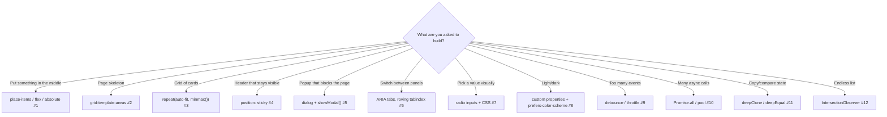

# Coding Interview: 12 Frontend Machine-Coding Problems

Frontend interviews include a **machine-coding round**: build a layout or widget in 45–60 minutes, then explain your choices.
Interviewers check four things: it **works at every screen size**, it's **accessible** (keyboard, screen readers), the code is
**modern and simple** (Grid, Flexbox, `<dialog>`, custom properties rather than hacks), and you can write the **core JavaScript utilities**
(debounce, `Promise.all`, deep clone) from memory.

Every solution here is a self-contained file you can open, read and resize. More importantly, every one is **verified in a real browser**:
[`coding-interview/run-tests.mjs`](https://github.com/khiruashish/web-ui-frontend-playbook/blob/main/coding-interview/run-tests.mjs)
uses Playwright and Chromium to measure real layout geometry at several viewport widths, press real keys, check focus and ARIA state,
and test the JavaScript utilities with mock timers. That's 42 checks, run by CI on every change. Each page shows the live demo and its real check report.

Writing those checks exposed four real bugs in the first drafts, and the pages keep them as lessons:
- invisible radio inputs stealing clicks from the star rating
- screen-reader text hidden with `hidden`
- an `IntersectionObserver` feed that stalls on tall screens
- a colour transition that fooled a test

Each page follows the same structure:

1. **Problem**: the statement as an interviewer would give it.
2. **Key idea**: the shape of the solution before any code, with a diagram.
3. **Solution**: the complete, runnable code (included from the repository, so it is exactly what CI ran).
4. **Walkthrough**: the important lines and *why* they are written that way.
5. **Complexity**: time and space for each approach.
6. **Run it**: the command and its real output.
7. **Common mistakes** and **follow-up questions** with answers.

## Problem map

| # | Problem | What it tests | Level | Difficulty |
|---|---|---|---|---|
| 1 | [Center Anything: Three Ways](01-centering.md) | Grid `place-items`, Flexbox, absolute + `translate` | <span class="level l1">L1</span> | ★☆☆ |
| 2 | [Holy Grail Layout with Grid Areas](02-holy-grail.md) | `grid-template-areas`, mobile first, `100dvh`, source order | <span class="level l1">L1</span> | ★★☆ |
| 3 | [Responsive Card Grid (No Media Queries)](03-card-grid.md) | `repeat(auto-fit, minmax())`, `min()`, subgrid-free alignment | <span class="level l1">L1</span> | ★★☆ |
| 4 | [Sticky Header & Sticky Table Header](04-sticky-header.md) | `position: sticky`, scroll containers, `scroll-padding-top` | <span class="level l1">L1</span> | ★★☆ |
| 5 | [Accessible Modal Dialog](05-modal-dialog.md) | `showModal()`, `::backdrop`, focus management, `method=dialog` | <span class="level l2">L2</span> | ★★☆ |
| 6 | [Accessible Tabs (Roving Tabindex)](06-tabs.md) | WAI-ARIA tabs pattern, `aria-selected`, arrow / Home / End keys | <span class="level l2">L2</span> | ★★★ |
| 7 | [Star Rating with Zero JavaScript](07-star-rating.md) | Radio inputs, `row-reverse` + `~`, visually-hidden pattern, `content: "★" / ""` | <span class="level l2">L2</span> | ★★☆ |
| 8 | [Dark Mode with Custom Properties](08-theme-toggle.md) | Design tokens, `prefers-color-scheme`, `data-theme` override, no flash | <span class="level l2">L2</span> | ★★☆ |
| 9 | [Debounce & Throttle from Scratch](09-debounce-throttle.md) | Timers, closures, `this`, leading/trailing edges, mock timers | <span class="level l2">L2</span> | ★★☆ |
| 10 | [Promise.all, allSettled & a Concurrency Pool](10-promise-utils.md) | Promise construction, input order, first rejection, async worker pool | <span class="level l2">L2</span> | ★★☆ |
| 11 | [deepClone & deepEqual (Cycles, Map, Set, Date)](11-deep-clone.md) | Recursion, `WeakMap` for cycles, prototypes, `Reflect.ownKeys`, `Object.is` | <span class="level l3">L3</span> | ★★★ |
| 12 | [Infinite Scroll with IntersectionObserver](12-infinite-scroll.md) | Sentinel + `rootMargin`, in-flight guard, `DocumentFragment`, end of feed | <span class="level l2">L2</span> | ★★★ |

Levels: <span class="level l1">L1</span> 0–2 yrs · <span class="level l2">L2</span> 2–5 yrs · <span class="level l3">L3</span> 5–10 yrs · <span class="level l4">L4</span> 10+ yrs / architect.

## Which technique fits? (the interviewer's hidden question)



## How to answer a coding round

1. **Clarify the target**: breakpoints, browsers, whether it must work without JavaScript, and accessibility expectations. Ask before you code.
2. **Semantic HTML first** (`<dialog>`, `<button>`, radio inputs, landmarks). Native elements give you keyboard and screen-reader support for free.
3. **Layout with Grid or Flexbox, mobile first**, and add complexity at larger breakpoints. Avoid fixed heights and magic numbers.
4. **Then the JavaScript**: small, event-driven, with no layout thrashing (batch DOM writes, use observers instead of scroll handlers).
5. **Demonstrate it**: resize the window, use only the keyboard, turn on dark mode. Say what you would test and how.

## Run every solution

```bash
cd coding-interview && npm ci && npx playwright install chromium
npm test          # all 42 checks, writes outputs/
npm run check     # what CI runs: fails on any failing check or changed report
```
