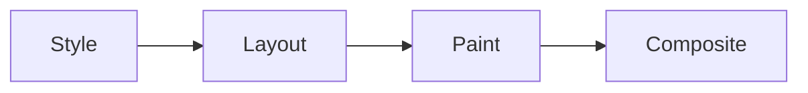

# Transforms, Transitions & Animations

Hover over and click the demos on this page; they're live.

## `transform` <span class="lvl lvl-1">Beginner</span> { #transform data-toc-label="transform" }

Transforms move, rotate, scale or skew an element **without affecting layout**: neighbours don't move.

```css
transform: translate(20px, 10px);
transform: rotate(15deg);
transform: scale(1.2);
transform: skew(10deg, 0);
transform: translateY(-4px) rotate(5deg) scale(1.05);  /* order matters: right to left */

/* Individual properties (Baseline 2022): easier to animate separately */
translate: 20px 10px;
rotate: 15deg;
scale: 1.2;

transform-origin: top left;
```

<div class="demo">
<div style="display:flex;flex-wrap:wrap;gap:2.2em;padding:1em .5em;font:600 12px system-ui">
  <div class="b" style="width:80px">none</div>
  <div class="b" style="width:80px;translate:10px 10px">translate</div>
  <div class="b" style="width:80px;rotate:15deg">rotate</div>
  <div class="b" style="width:80px;scale:1.2">scale</div>
  <div class="b" style="width:80px;transform:skew(15deg)">skew</div>
</div>
</div>

### 3D transforms <span class="lvl lvl-2">Intermediate</span> { #3d-transforms data-toc-label="3D transforms" }

```css
.scene { perspective: 600px; }
.card  { transition: transform .6s; transform-style: preserve-3d; }
.scene:hover .card { transform: rotateY(180deg); }
.face  { backface-visibility: hidden; position: absolute; inset: 0; }
.back  { transform: rotateY(180deg); }
```

<div class="demo">
<div class="anim-flip">
  <div class="card3d">
    <div class="face front">Hover me</div>
    <div class="face back">Back side 🎉</div>
  </div>
</div>
<style>
  .anim-flip { perspective: 600px; width: 180px; height: 110px; }
  .anim-flip .card3d { position: relative; width: 100%; height: 100%; transition: transform .6s; transform-style: preserve-3d; }
  .anim-flip:hover .card3d { transform: rotateY(180deg); }
  .anim-flip .face { position: absolute; inset: 0; display: grid; place-items: center; border-radius: 12px; backface-visibility: hidden; font-weight: 700; color: #fff; }
  .anim-flip .front { background: linear-gradient(135deg, #e4572e, #f3a712); }
  .anim-flip .back { background: linear-gradient(135deg, #3f51b5, #7c4dff); transform: rotateY(180deg); }
</style>
</div>

## `transition` <span class="lvl lvl-1">Beginner</span> { #transition data-toc-label="transition" }

Animates between two states (e.g. normal → `:hover`).

```css
.btn {
  background: #e4572e;
  transition: background-color .2s ease, translate .2s ease, box-shadow .2s ease;
  /* transition: property duration timing-function delay; */
}
.btn:hover {
  background: #c43d17;
  translate: 0 -2px;
  box-shadow: 0 6px 16px rgb(0 0 0 / .2);
}
```

<div class="demo">
<button class="anim-btn">Hover me</button>
<style>
  .anim-btn { background: #e4572e; color: #fff; border: 0; padding: .8em 1.6em; border-radius: 8px; font-weight: 700; cursor: pointer; transition: background-color .2s ease, translate .2s ease, box-shadow .2s ease; }
  .anim-btn:hover { background: #c43d17; translate: 0 -2px; box-shadow: 0 6px 16px rgb(0 0 0 / .2); }
  .anim-btn:active { translate: 0 0; box-shadow: none; }
</style>
</div>

### Timing functions <span class="lvl lvl-2">Intermediate</span> { #timing-functions data-toc-label="Timing functions" }

Hover the track to see each curve.

```css
transition-timing-function: linear;
transition-timing-function: ease;          /* default */
transition-timing-function: ease-in;
transition-timing-function: ease-out;      /* good for entering elements */
transition-timing-function: ease-in-out;
transition-timing-function: cubic-bezier(.34, 1.56, .64, 1);   /* overshoot / spring */
transition-timing-function: steps(5);
transition-timing-function: linear(0, 1.2 60%, .9 80%, 1);     /* bounce (Baseline 2023) */
```

<div class="demo">
<div class="anim-ease">
  <div><span>linear</span><i style="transition-timing-function:linear"></i></div>
  <div><span>ease</span><i style="transition-timing-function:ease"></i></div>
  <div><span>ease-in</span><i style="transition-timing-function:ease-in"></i></div>
  <div><span>ease-out</span><i style="transition-timing-function:ease-out"></i></div>
  <div><span>cubic-bezier</span><i style="transition-timing-function:cubic-bezier(.34,1.56,.64,1)"></i></div>
  <div><span>steps(5)</span><i style="transition-timing-function:steps(5)"></i></div>
</div>
<style>
  .anim-ease { display: grid; gap: .3em; padding: .3em; border-radius: 8px; }
  .anim-ease div { display: grid; grid-template-columns: 100px 1fr; align-items: center; font: 12px system-ui; }
  .anim-ease i { display: block; width: 24px; height: 24px; border-radius: 50%; background: #e4572e; transition-property: translate; transition-duration: 1.2s; }
  .anim-ease:hover i { translate: calc(min(60vw, 420px) - 24px) 0; }
</style>
</div>

### Transition `display` and entry states <span class="lvl lvl-3">Advanced</span> <small>Baseline 2024</small> { #transition-display-and-entry-states data-toc-label="Transition display and entry states" }

```css
.toast {
  transition: opacity .3s, translate .3s, display .3s allow-discrete;
  @starting-style { opacity: 0; translate: 0 1rem; }   /* where it animates FROM when it appears */
}
.toast[hidden] { display: none; opacity: 0; }
```

`@starting-style` and `transition-behavior: allow-discrete` finally allow fade-in/fade-out when toggling `display: none`, including for `<dialog>` and popovers.

## `@keyframes` and `animation` <span class="lvl lvl-1">Beginner</span> → <span class="lvl lvl-2">Intermediate</span> { #keyframes-and-animation data-toc-label="@keyframes and animation" }

```css
@keyframes spin    { to { rotate: 360deg; } }
@keyframes pulse   { 50% { scale: 1.15; opacity: .7; } }
@keyframes bounce  { 0%, 100% { translate: 0 0; } 50% { translate: 0 -20px; } }
@keyframes shimmer { to { background-position: -200% 0; } }

.spinner  { animation: spin 1s linear infinite; }
.pulse    { animation: pulse 1.5s ease-in-out infinite; }
.bounce   { animation: bounce .8s ease-in-out infinite; }
.skeleton {
  background: linear-gradient(90deg, #eee 25%, #f8f8f8 50%, #eee 75%) 0 0 / 200% 100%;
  animation: shimmer 1.4s linear infinite;
}
```

<div class="demo">
<div class="anim-kf">
  <div class="spinner" aria-label="Loading"></div>
  <div class="pulse"></div>
  <div class="bounce"></div>
  <div class="skel"><span></span><span></span><span style="width:60%"></span></div>
</div>
<style>
  @keyframes pb-spin { to { rotate: 360deg; } }
  @keyframes pb-pulse { 50% { scale: 1.15; opacity: .7; } }
  @keyframes pb-bounce { 0%, 100% { translate: 0 0; } 50% { translate: 0 -20px; } }
  @keyframes pb-shimmer { to { background-position: -200% 0; } }
  .anim-kf { display: flex; flex-wrap: wrap; gap: 2em; align-items: center; padding-top: 1em; }
  .anim-kf .spinner { width: 36px; height: 36px; border: 4px solid #ddd; border-top-color: #e4572e; border-radius: 50%; animation: pb-spin 1s linear infinite; }
  .anim-kf .pulse { width: 36px; height: 36px; border-radius: 50%; background: #3f51b5; animation: pb-pulse 1.5s ease-in-out infinite; }
  .anim-kf .bounce { width: 30px; height: 30px; border-radius: 50%; background: #2e9d4f; animation: pb-bounce .8s ease-in-out infinite; }
  .anim-kf .skel { display: grid; gap: .4em; width: 200px; }
  .anim-kf .skel span { display: block; height: 12px; border-radius: 6px; background: linear-gradient(90deg, #ddd 25%, #f4f4f4 50%, #ddd 75%) 0 0 / 200% 100%; animation: pb-shimmer 1.4s linear infinite; }
</style>
</div>

| Property | Values |
|---|---|
| `animation-name` | the `@keyframes` name |
| `animation-duration` | `1s`, `300ms` |
| `animation-timing-function` | as transitions |
| `animation-delay` | `0.2s`, negative values start mid-way |
| `animation-iteration-count` | `1`, `3`, `infinite` |
| `animation-direction` | `normal`, `reverse`, `alternate`, `alternate-reverse` |
| `animation-fill-mode` | `none`, `forwards` (keep end state), `backwards`, `both` |
| `animation-play-state` | `running`, `paused` |
| `animation-composition` | `replace`, `add`, `accumulate` |
| `animation-timeline` | `auto`, `scroll()`, `view()` (see below) |

## Scroll-driven animations <span class="lvl lvl-3">Advanced</span> <small>Chromium 115+, Safari 26</small> { #scroll-driven-animations data-toc-label="Scroll-driven animations" }

Link an animation's progress to scrolling, with no JavaScript.

```css
/* Reading progress bar */
.progress {
  position: fixed; inset: 0 0 auto; height: 4px; background: #e4572e;
  transform-origin: left;
  animation: grow linear both;
  animation-timeline: scroll(root);
}
@keyframes grow { from { scale: 0 1; } to { scale: 1 1; } }

/* Fade cards in as they enter the viewport */
.card {
  animation: reveal linear both;
  animation-timeline: view();
  animation-range: entry 0% entry 100%;
}
@keyframes reveal { from { opacity: 0; translate: 0 2rem; } }
```

Scroll inside the box (in a supporting browser):

<div class="demo">
<div class="anim-sd">
  <div class="bar"></div>
  <p>Scroll me ↓ — the orange bar tracks progress, and each block fades in as it enters.</p>
  <div class="b">Block 1</div><div class="b">Block 2</div><div class="b">Block 3</div><div class="b">Block 4</div><div class="b">Block 5</div><div class="b">Block 6</div>
</div>
<style>
  .anim-sd { height: 200px; overflow: auto; position: relative; scroll-timeline: --sd block; border: 1px solid #c9ced6; border-radius: 8px; padding: 0 .8em .8em; }
  .anim-sd .bar { position: sticky; top: 0; height: 5px; margin: 0 -.8em; background: #e4572e; transform-origin: left; animation: pb-grow linear both; animation-timeline: --sd; }
  .anim-sd .b { margin-top: 1em; padding: 1.4em; animation: pb-reveal linear both; animation-timeline: view(); animation-range: entry 0% entry 100%; }
  @keyframes pb-grow { from { scale: 0 1; } to { scale: 1 1; } }
  @keyframes pb-reveal { from { opacity: 0; translate: 0 2rem; } }
</style>
</div>

Wrap them in `@supports (animation-timeline: view()) { … }` so other browsers simply show the content without the effect.

## View transitions <span class="lvl lvl-3">Advanced</span> <small>Same-document: Baseline 2025</small> { #view-transitions data-toc-label="View transitions" }

Animate between two DOM states (or two pages) with a cross-fade or morph.

```js
// Same-document (SPA): wrap the DOM change
document.startViewTransition(() => updateTheDOM());
```

```css
/* Cross-document (MPA): opt in on both pages */
@view-transition { navigation: auto; }

/* Morph a thumbnail into a hero image across pages */
.thumb, .hero { view-transition-name: product-photo; }

::view-transition-old(root), ::view-transition-new(root) { animation-duration: .3s; }
```

<div class="demo">
<button type="button" onclick="(function(){var g=document.getElementById('vt-grid');var f=function(){g.classList.toggle('vt-alt')};document.startViewTransition?document.startViewTransition(f):f()})()">Shuffle layout</button>
<div id="vt-grid" class="vt-grid">
  <div class="b" style="view-transition-name:vt1">1</div>
  <div class="b" style="view-transition-name:vt2">2</div>
  <div class="b" style="view-transition-name:vt3">3</div>
  <div class="b" style="view-transition-name:vt4">4</div>
</div>
<style>
  .vt-grid { display: grid; grid-template-columns: repeat(4, 1fr); gap: .5em; margin-top: .8em; }
  .vt-grid.vt-alt { grid-template-columns: 2fr 1fr; }
  .vt-grid.vt-alt .b:first-child { grid-row: span 2; }
  .vt-grid .b { padding: 1.4em 0; }
</style>
</div>

## Accessibility: reduced motion <span class="lvl lvl-2">Intermediate</span> { #accessibility-reduced-motion data-toc-label="Accessibility: reduced motion" }

Some people get dizzy or nauseous from motion (vestibular disorders). Respect their OS setting:

```css
@media (prefers-reduced-motion: no-preference) {
  .card { transition: translate .3s; }     /* only add motion if the user is OK with it */
}

@media (prefers-reduced-motion: reduce) {
  .hero-video { display: none; }
  * { animation-duration: .01ms !important; transition-duration: .01ms !important; }
}
```

## Performance rules <span class="lvl lvl-3">Advanced</span> { #performance-rules data-toc-label="Performance rules" }



| Animating… | Triggers | Cost |
|---|---|---|
| `transform`, `opacity` (+ `translate`, `rotate`, `scale`, `filter` in many cases) | Composite only | ✅ Cheap: runs on the GPU compositor thread |
| `color`, `background`, `box-shadow`, `border-radius` | Paint + composite | ⚠️ Moderate |
| `width`, `height`, `top`, `left`, `margin`, `padding`, `font-size` | Layout + paint + composite | ❌ Expensive: whole page may re-layout every frame |

!!! tip "Senior note · 🟠 Advanced"
    - Animate `transform`/`opacity`. To "animate height", use a `grid-template-rows: 0fr → 1fr` transition, `interpolate-size: allow-keywords` with `height: auto`, or `scale`.
    - `will-change: transform` promotes an element to its own layer. Add it just before an animation and remove it after; leaving it on hundreds of elements wastes GPU memory.
    - Keep UI transitions between 150–300ms. Entering: `ease-out`. Exiting: `ease-in`. Anything over 500ms feels sluggish for UI feedback.
