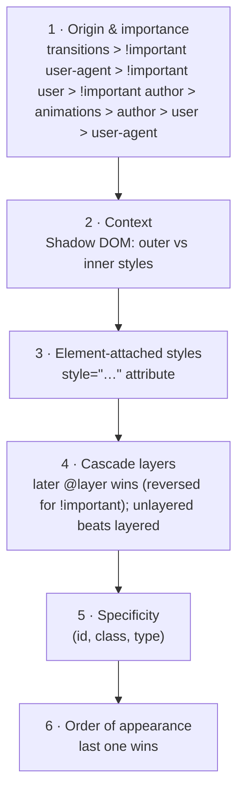

# Cascade, Specificity & Box Model

## The cascade <span class="lvl lvl-1">Beginner</span> → <span class="lvl lvl-3">Advanced</span> { #the-cascade data-toc-label="The cascade" }

When two rules set the same property on the same element, the **cascade** decides who wins. It checks these in order and stops at the first difference:



For day-to-day work, the three that matter are **layers → specificity → order**.

```html
<p class="note" id="intro">Which colour am I?</p>

<style>
  p        { color: green; }   /* (0,0,1) */
  .note    { color: blue; }    /* (0,1,0) */
  #intro   { color: crimson; } /* (1,0,0) wins: highest specificity */
  .note    { color: orange; }  /* same specificity as .note above; later, but still loses to #intro */
</style>
```

<div class="demo spec-demo">
<p id="spec-intro" class="spec-note">Which colour am I?</p>
<style>
  .spec-demo p { color: green; }
  .spec-demo .spec-note { color: blue; }
  .spec-demo #spec-intro { color: crimson; }
  .spec-demo .spec-note { color: orange; }
</style>
</div>

## Specificity <span class="lvl lvl-1">Beginner</span> { #specificity data-toc-label="Specificity" }

Specificity is a score of three numbers: **(IDs, classes, types)**. Compare left to right; the first higher number wins. `1,0,0` beats `0,15,0`.

| Selector | Score | Why |
|---|---|---|
| `*` | 0,0,0 | Universal adds nothing |
| `li` | 0,0,1 | 1 type |
| `ul li` | 0,0,2 | 2 types |
| `.nav` | 0,1,0 | 1 class |
| `a:hover` | 0,1,1 | pseudo-class counts as a class |
| `[type="email"]` | 0,1,0 | attribute counts as a class |
| `li::before` | 0,0,2 | pseudo-element counts as a type |
| `#main .nav a` | 1,1,1 | |
| `:is(#a, .b) p` | 1,0,1 | `:is()` takes its **most specific** argument |
| `:where(#a, .b) p` | 0,0,1 | `:where()` is **always 0** |
| `:not(.x)` | 0,1,0 | takes its argument's specificity |
| `style="…"` | beats all selectors | |
| `!important` | jumps to a higher origin | Use only to override third-party CSS or in utilities |

!!! tip "Senior note · 🟠 Advanced"
    Keep specificity **low and flat**: mostly single classes. Use `:where()` in resets and libraries so users can override them with a single class. Use `@layer` instead of specificity hacks to manage order between reset, base, components and utilities. See [Modern CSS → @layer](modern-css.md#layer-cascade-layers).

## Inheritance <span class="lvl lvl-1">Beginner</span> { #inheritance data-toc-label="Inheritance" }

Some properties pass down from parent to children: mostly **text** properties (`color`, `font-*`, `line-height`, `letter-spacing`, `text-align`, `visibility`, `cursor`, `list-style`). **Box** properties (`margin`, `padding`, `border`, `background`, `width`, `display`) do not.

```css
.parent { color: purple; border: 2px solid purple; }
/* Children are purple text, but get no border. */
```

<div class="demo">
<div style="color:purple;border:2px solid purple;padding:.5em">Parent
  <p style="margin:.3em 0 0;padding-left:1em">Child: purple text inherited, no border</p>
</div>
</div>

Control inheritance with these keywords, which work on any property:

| Keyword | Means |
|---|---|
| `inherit` | Use the parent's value |
| `initial` | Use the spec's initial value (`display: initial` is `inline`!) |
| `unset` | `inherit` if the property inherits, otherwise `initial` |
| `revert` | Go back to the browser's default style |
| `revert-layer` | Go back to the value from the previous cascade layer |

## The box model <span class="lvl lvl-1">Beginner</span> { #the-box-model data-toc-label="The box model" }

Every element is a rectangular box made of four layers:

<div class="demo">
<div style="background:#f9cc9d;padding:18px;display:inline-block;font:12px/1.2 system-ui;color:#222;text-align:center">margin
  <div style="background:#fddd9b;padding:18px;border:0;margin-top:6px;outline:0">border
    <div style="background:#c3d08b;padding:18px;margin-top:6px">padding
      <div style="background:#8cb6c0;padding:18px 34px;margin-top:6px">content<br>width × height</div>
    </div>
  </div>
</div>
</div>

```css
.box {
  width: 200px;
  padding: 20px;
  border: 5px solid;
  margin: 10px;
}
```

| `box-sizing` | Total visible width | |
|---|---|---|
| `content-box` (default) | 200 + 20×2 + 5×2 = **250px** | `width` = content only |
| `border-box` | **200px** | `width` includes padding + border |

That's why every modern reset sets `*, *::before, *::after { box-sizing: border-box; }`.

```html
<div class="cb">content-box</div>
<div class="bb">border-box</div>
```

```css
.cb, .bb { width: 200px; padding: 20px; border: 5px solid; }
.cb { box-sizing: content-box; }
.bb { box-sizing: border-box; }
```

<div class="demo">
<div style="width:200px;padding:20px;border:5px solid #e4572e;box-sizing:content-box;margin-bottom:8px">content-box (250px)</div>
<div style="width:200px;padding:20px;border:5px solid #3f51b5;box-sizing:border-box">border-box (200px)</div>
</div>

### Shorthand order <span class="lvl lvl-1">Beginner</span> { #shorthand-order data-toc-label="Shorthand order" }

```css
margin: 10px;                 /* all four */
margin: 10px 20px;            /* block (top/bottom) | inline (left/right) */
margin: 10px 20px 30px;       /* top | inline | bottom */
margin: 10px 20px 30px 40px;  /* top | right | bottom | left: clockwise */
margin-inline: auto;          /* centre a block with a width */
```

## `display` <span class="lvl lvl-1">Beginner</span> { #display data-toc-label="display" }

| Value | Behaviour |
|---|---|
| `block` | New line, full width, respects width/height |
| `inline` | Flows in text; **ignores width/height and vertical margin** |
| `inline-block` | Flows in text, but respects width/height/margins |
| `flex` / `inline-flex` | Flex container ([Flexbox](../layout/flexbox.md)) |
| `grid` / `inline-grid` | Grid container ([Grid](../layout/grid.md)) |
| `none` | Removed from layout and accessibility tree |
| `contents` | The box disappears; children act as if they're the parent's children |
| `flow-root` | Block that creates a new formatting context (contains floats, stops margin collapse) |
| `table`, `table-row`, `table-cell`… | Table layout without table elements |
| `list-item` | Block with a `::marker` |

```html
<span class="i">inline</span><span class="i">inline</span>
<span class="ib">inline-block</span><span class="ib">inline-block</span>
<span class="bl">block</span>
```

<div class="demo">
<span style="background:var(--box-a);width:200px;padding:.4em">inline (width ignored)</span><span style="background:var(--box-b);padding:.4em">inline</span><br><br>
<span style="display:inline-block;background:var(--box-c);width:160px;padding:.4em">inline-block 160px</span> <span style="display:inline-block;background:var(--box-d);width:160px;padding:.4em">inline-block 160px</span>
<span style="display:block;background:var(--box-e);padding:.4em;margin-top:.5em">block: full width, own line</span>
</div>

### `display: none` vs `visibility: hidden` vs `opacity: 0`

| | Takes space? | Clickable? | Screen readers? | Animatable? |
|---|---|---|---|---|
| `display: none` | ❌ | ❌ | ❌ | with `transition-behavior: allow-discrete` |
| `visibility: hidden` | ✅ | ❌ | ❌ | ✅ (discrete) |
| `opacity: 0` | ✅ | ✅ | ✅ (still read!) | ✅ |
| `.visually-hidden` | ❌ | ❌ | ✅ | — |

```css
/* Hide visually, keep for screen readers */
.visually-hidden {
  clip: rect(0 0 0 0); clip-path: inset(50%);
  height: 1px; width: 1px; overflow: hidden;
  position: absolute; white-space: nowrap;
}
```

## Margin collapse <span class="lvl lvl-2">Intermediate</span> { #margin-collapse data-toc-label="Margin collapse" }

Vertical margins between **block** elements in normal flow merge into the larger of the two. They don't add up.

```css
h2 { margin-bottom: 30px; }
p  { margin-top: 20px; }
/* Gap between them = 30px, not 50px */
```

Margins **don't** collapse inside flex or grid containers, or across a parent with padding, a border, or `display: flow-root`. A common surprise: a child's top margin "leaking" out of its parent. Fix it with `display: flow-root` on the parent, or use `gap` instead of margins.

!!! tip "Senior note · 🟡 Intermediate"
    Many teams avoid margin collapse entirely by using **one direction only** (`margin-block-end`) or, better, layout `gap` and the "stack" pattern: `.stack > * + * { margin-block-start: var(--space, 1rem); }`.

## Logical properties <span class="lvl lvl-2">Intermediate</span> { #logical-properties data-toc-label="Logical properties" }

Logical properties follow the writing direction, so layouts flip automatically for right-to-left languages and vertical writing modes.

| Physical | Logical |
|---|---|
| `width` / `height` | `inline-size` / `block-size` |
| `margin-left` / `margin-right` | `margin-inline-start` / `margin-inline-end` |
| `margin-top` / `margin-bottom` | `margin-block-start` / `margin-block-end` |
| `padding-left` + `padding-right` | `padding-inline` |
| `top` / `bottom` / `left` / `right` | `inset-block-start` / … / `inset-inline-end` |
| `text-align: left` | `text-align: start` |
| `border-top-left-radius` | `border-start-start-radius` |

## Formatting contexts <span class="lvl lvl-4">Expert</span> { #formatting-contexts data-toc-label="Formatting contexts" }

A **block formatting context (BFC)** is an isolated layout region: floats inside it are contained, and its children's margins don't collapse with outside margins. These create one: the root element, floats, absolutely positioned elements, `display: flow-root`, `inline-block`, table cells, `overflow` other than `visible`/`clip`, flex and grid items, `contain: layout | content | paint`, and multi-column containers. Knowing this explains most "why does my margin/float behave differently in here?" bugs.
