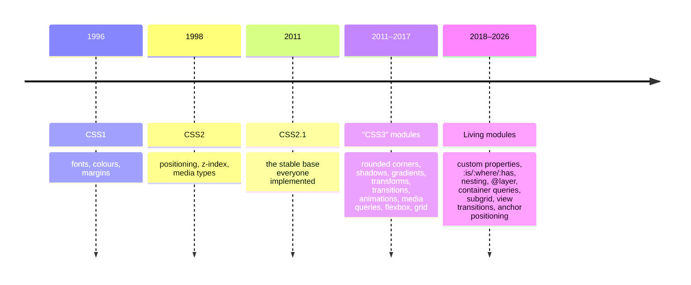

# CSS & CSS3: How It Works

CSS (Cascading Style Sheets) controls how HTML looks: colours, spacing, fonts, layout, animation.

## Anatomy of a rule <span class="lvl lvl-1">Beginner</span> { #anatomy-of-a-rule data-toc-label="Anatomy of a rule" }

```css
/* selector    { property: value; } */
   .card       { background: white; padding: 1rem; }
```

| Part | Example | Meaning |
|---|---|---|
| Selector | `.card` | Which elements to style |
| Declaration block | `{ … }` | The styles |
| Declaration | `padding: 1rem;` | One property + value |
| Property | `padding` | What to change |
| Value | `1rem` | What to change it to |

## Three ways to add CSS <span class="lvl lvl-1">Beginner</span> { #three-ways-to-add-css data-toc-label="Three ways to add CSS" }

```html
<!-- 1. External stylesheet (best: cached, reusable) -->
<link rel="stylesheet" href="styles.css">

<!-- 2. Internal <style> (single page, critical CSS) -->
<style>
  h1 { color: #e4572e; }
</style>

<!-- 3. Inline style attribute (one element; dynamic values) -->
<h1 style="color: #e4572e">Hello</h1>
```

<div class="demo">
<h1 style="color:#e4572e;margin:0">Hello</h1>
</div>

## What "CSS3" means <span class="lvl lvl-2">Intermediate</span> { #what-css3-means data-toc-label="What &quot;CSS3&quot; means" }



After CSS2.1, CSS was split into **independent modules** (Selectors, Color, Flexbox, Grid…), each with its own level number. "CSS3" is just a marketing label for that first wave. There will never be a "CSS4"; the CSS Working Group publishes yearly snapshots instead, and developers track **Baseline** to see what's safe to use.

!!! info "Baseline"
    [Baseline](https://web.dev/baseline) marks a web feature as:

    - **Newly available**: works in the latest Chrome, Edge, Firefox and Safari.
    - **Widely available**: has been newly available for 30+ months, so it's safe for almost every audience.

    Throughout this playbook, newer features are labelled with their Baseline year.

## A modern starter stylesheet <span class="lvl lvl-1">Beginner</span> { #a-modern-starter-stylesheet data-toc-label="A modern starter stylesheet" }

Copy this into every new project. Every line is explained in the following chapters.

```css
/* 1. Predictable sizing */
*, *::before, *::after { box-sizing: border-box; }

/* 2. Remove default margins, keep sensible text */
* { margin: 0; }
html { -webkit-text-size-adjust: none; text-size-adjust: none; color-scheme: light dark; }
body {
  min-block-size: 100dvh;
  line-height: 1.5;
  font-family: system-ui, -apple-system, "Segoe UI", Roboto, sans-serif;
  -webkit-font-smoothing: antialiased;
}

/* 3. Media is responsive by default */
img, picture, video, canvas, svg { display: block; max-inline-size: 100%; height: auto; }

/* 4. Form controls inherit fonts */
input, button, textarea, select { font: inherit; }

/* 5. Avoid text overflow and ugly line breaks */
p, h1, h2, h3, h4, h5, h6 { overflow-wrap: break-word; }
h1, h2, h3 { text-wrap: balance; line-height: 1.15; }
p { text-wrap: pretty; }

/* 6. Visible keyboard focus */
:focus-visible { outline: 3px solid #e4572e; outline-offset: 2px; }

/* 7. Respect reduced-motion preferences */
@media (prefers-reduced-motion: reduce) {
  *, *::before, *::after {
    animation-duration: .01ms !important;
    animation-iteration-count: 1 !important;
    transition-duration: .01ms !important;
    scroll-behavior: auto !important;
  }
}
```

## Chapters

| Page | Topics |
|---|---|
| [Cascade, Specificity & Box Model](fundamentals.md) | How conflicts are resolved; the box model; `display`; margin collapse |
| [Selectors](selectors.md) | Every selector, including `:has()`, `:is()`, `:where()` |
| [Colours & Units](colors-units.md) | `oklch()`, `color-mix()`, `rem`, `clamp()`, `dvh`, container units |
| [Typography](typography.md) | Font stacks, variable fonts, fluid type, line clamping |
| [Backgrounds, Borders & Effects](effects.md) | Gradients, shadows, filters, `clip-path`, blend modes |
| [Positioning & Stacking](positioning.md) | `position`, `z-index`, stacking contexts, `aspect-ratio` |
| [Transforms, Transitions & Animations](animations.md) | 2D/3D transforms, keyframes, view transitions, scroll-driven animations |
| [Custom Properties & Theming](custom-properties.md) | Variables, dark mode, design tokens |
| [Modern CSS](modern-css.md) | Nesting, `@layer`, `@container`, `@scope`, anchor positioning… |
| [Property Cheat Sheet](properties.md) | ~200 properties at a glance |
