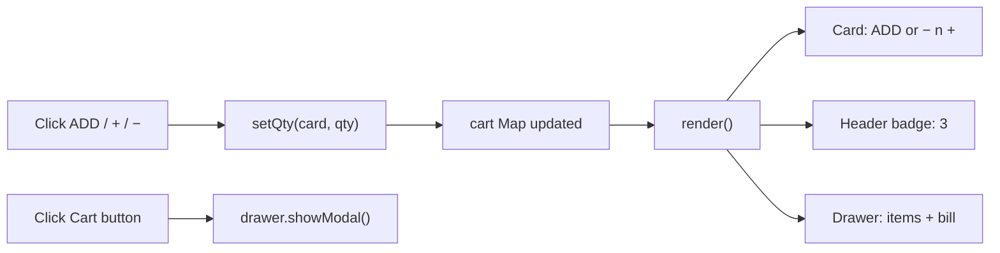

# 6. Cart Drawer

<span class="lvl lvl-2">Intermediate</span>

The cart drawer slides in from the right when you tap the cart button. It lists what you've added, shows the bill (items total,
delivery fee, amount to pay) and a checkout button. It is built on the native `<dialog>` element, which gives us focus trapping, the
++esc++ key and a dark backdrop for free.

## What you see

<iframe src="../demos/06-cart.html" title="Cart drawer: live demo" style="width:100%;height:640px;border:1px solid var(--md-default-fg-color--lightest);border-radius:12px" loading="lazy"></iframe>

Add a few products, then click **Cart** in the header. Close it with ×, ++esc++, or a click on the dark area. Open it full-size:
[06-cart.html](demos/06-cart.html){ target=_blank }.



The key idea: **state → render**. Clicks never edit the screen directly. They change the `cart` Map, and `render()` redraws
everything from it. The badge, the cards and the drawer can never disagree.

## The HTML

```html
--8<-- "docs/ecommerce/demos/store.html:cart"
```

| Code | What it does |
|---|---|
| `<dialog class="cart-drawer" id="cart" aria-labelledby="cart-title">` | A native dialog, hidden until opened. `aria-labelledby` gives it the name "My cart". |
| `<div class="cart-head">` | Top bar: title + close button. |
| `<h2 id="cart-title">My cart</h2>` | The dialog's heading and accessible name. |
| `<form method="dialog">` | **A form that closes the dialog.** Submitting it (clicking any button inside) closes the `<dialog>`, no JavaScript needed. |
| `<button class="close-btn" aria-label="Close cart">×</button>` | The × symbol needs a real label for screen readers. |
| `<div class="cart-body">` | The scrolling middle part. |
| `<p class="cart-empty" data-cart-empty>` | Shown only when the cart is empty. Always design the empty state. |
| `<ul class="cart-items" data-cart-items></ul>` | Empty in HTML; JavaScript fills it with one `<li>` per product. |
| `<div class="cart-foot">` | The bill, pinned to the bottom. |
| `<dl>` with `<dt>` / `<dd>` | A **description list**: name/value pairs. The right element for "Items total → ₹446". |
| `<dd data-subtotal>` etc. | JavaScript writes the amounts here. |
| `<button class="btn" type="button">Proceed to checkout</button>` | The final call to action. In a real store this goes to the checkout page. |

## The CSS: turning a dialog into a drawer

```css
--8<-- "docs/ecommerce/demos/css/cart.css:drawer"
```

| Code | What it does |
|---|---|
| `width: min(400px, 100%);` | 400 px wide on desktop, full width on a phone. |
| `max-width: none; max-height: none;` | Dialogs have a built-in maximum size with a margin around them; remove it. |
| `height: 100dvh;` | Full height of the screen. `dvh` (dynamic viewport height) accounts for the phone's address bar showing and hiding; `100vh` would be too tall on mobile. |
| `margin: 0 0 0 auto;` | Dialogs are centred by default (`margin: auto`). Zero on top, right and bottom, `auto` on the left, pushes it to the **right edge**. |
| `padding: 0; border: 0;` | Removes the default dialog padding and border. |
| `.cart-drawer[open] { display: flex; flex-direction: column; }` | Only when open: stack head, body and foot vertically. (Don't set `display` on a closed dialog, or it would always show.) |
| `animation: slide-in 0.2s ease-out;` | Plays the slide-in animation when it opens. |
| `::backdrop { background: rgb(0 0 0 / 0.5); }` | The dark see-through layer behind a modal dialog, covering the page. |
| `@keyframes slide-in { from { transform: translateX(100%); } }` | Starts one full drawer-width to the right (off-screen) and animates to its normal position. Leaving out `to` means "to the normal style". |
| `@media (prefers-reduced-motion: reduce)` | Some people get motion sickness and turn on "reduce motion" in their phone or OS settings. We respect it: no animation. |

```css
--8<-- "docs/ecommerce/demos/css/cart.css:parts"
```

| Code | What it does |
|---|---|
| `.cart-head { display: flex; justify-content: space-between; }` | Title left, × right. |
| `.close-btn { border: 0; background: none; font-size: 1.5rem; }` | A plain big ×. |
| `.cart-body { flex: 1; overflow-y: auto; }` | **The sticky-footer trick.** `flex: 1` makes the body take all the height left between head and foot; `overflow-y: auto` scrolls the items if there are many, while the bill stays visible. |
| `.cart-items { display: grid; gap: … }` | Items stacked with 8 px gaps. |
| `.cart-items li { display: grid; grid-template-columns: 1fr auto auto; }` | Each item row: name (all spare space), "× 2", price. |
| `.cart-foot dl { display: grid; grid-template-columns: 1fr auto; }` | Turns the description list into a two-column bill: labels left, amounts right. Each `dt`/`dd` pair fills one row automatically. |
| `.cart-foot dd { margin: 0; text-align: right; }` | Removes the default `dd` indent and right-aligns the money. |
| `.cart-foot .btn { width: 100%; }` | A full-width checkout button: the easiest thing to tap. |

## The JavaScript

### Money: always whole paise

```js
--8<-- "docs/ecommerce/demos/js/store.js:money"
```

| Code | What it does |
|---|---|
| `new Intl.NumberFormat("en-IN", { style: "currency", currency: "INR", maximumFractionDigits: 0 })` | The browser's built-in formatter. Gives `₹1,23,456` with Indian digit grouping. Change to `"en-US"` / `"USD"` for `$1,234`. |
| `const formatPaise = (paise) => rupees.format(paise / 100);` | Store and add in paise; divide by 100 **only** to display. |
| `FREE_DELIVERY_FROM = 19900` | ₹199, the free-delivery threshold from the announcement bar. Named constants beat magic numbers. |
| `DELIVERY_FEE = 2500` | ₹25 when the order is below the threshold. |

### Rendering the drawer (the end of `render()`)

```js
--8<-- "docs/ecommerce/demos/js/store.js:render"
```

| Code | What it does |
|---|---|
| `subtotal += item.qty * item.price;` | Whole-number maths only: exact. |
| `if (!list) return;` | Pages without a drawer (the product-card demo) stop here. |
| `list.replaceChildren(...items)` | Removes all old `<li>`s and inserts the new ones in one step. |
| `[...cart.values()].map((item) => { … })` | One `<li>` per cart item. |
| ``li.innerHTML = `<span></span>…` `` | Builds the row's structure from a template with only **our own** markup and numbers in it. |
| `li.firstElementChild.textContent = item.name;` | The product name goes in with `textContent`, which never runs HTML. If a name ever contained ``, `innerHTML` would execute it (XSS); `textContent` just shows the text. |
| `document.querySelector("[data-cart-empty]").hidden = count > 0;` | Show the empty message only when there's nothing in the cart. |
| `const delivery = subtotal === 0 || subtotal >= FREE_DELIVERY_FROM ? 0 : DELIVERY_FEE;` | No fee for an empty cart or orders of ₹199 or more; otherwise ₹25. |
| `delivery ? formatPaise(delivery) : "FREE"` | Show the word "FREE" instead of "₹0": small copy details sell. |
| `formatPaise(subtotal + delivery)` | The amount to pay. |

### Opening and closing

```js
--8<-- "docs/ecommerce/demos/js/store.js:drawer"
```

| Code | What it does |
|---|---|
| `document.querySelectorAll("[data-open-cart]")` | Both the header cart button **and** the bottom-nav Cart link open the drawer. A data attribute lets any element do it. |
| `event.preventDefault();` | The bottom-nav opener is a link to `#`; this stops it jumping to the top of the page. |
| `drawer?.showModal();` | Opens the dialog as **modal**: focus moves inside it, ++tab++ stays inside it, ++esc++ closes it, the page behind can't be clicked, and focus returns to the cart button when it closes. Writing all that by hand takes ~100 lines. |
| `if (event.target === drawer) drawer.close();` | Clicks on the drawer's contents have a child element as `target`. A click on the **backdrop** is reported on the `<dialog>` itself, so that's when we close. |

## Try it

1. Add a "Remove" (🗑) button to each cart row that sets the quantity to 0.
2. Show "Add ₹X more for free delivery" in the cart footer when the subtotal is below ₹199.
3. Save the cart in `localStorage` so it survives a page refresh (`JSON.stringify([...cart])` to save, `new Map(JSON.parse(…))` to load).

### Solutions

Try each exercise yourself first, then open its solution to compare.

Every code solution below is applied in **[store-solved.html](demos/store-solved.html){ target=_blank }**: the full store with all the exercises from every lesson done, tested in a real browser like the original. Its files are generated from `store.html` and `store.js`, so the snippets here are exactly what runs there.

??? success "1. A 🗑 Remove button in each cart row"
    Each row needs to know **which product** it is, so loop over the Map's `[id, item]` pairs instead of only its values:

    ```js
    --8<-- "docs/ecommerce/demos/js/store-solved.js:sol-06-1-render"
    ```

    One listener on the list handles every 🗑 button, now and after every re-render:

    ```js
    --8<-- "docs/ecommerce/demos/js/store-solved.js:sol-06-1-click"
    ```

    ```css
    --8<-- "docs/ecommerce/demos/css/solutions.css:sol-06-1"
    ```

    Removing goes through the same `setQty()` as the product cards, so the card goes back to ADD, the badge updates and the bill is
    recalculated: one state, one `render()`.

??? success "2. “Add ₹X more for free delivery”"
    ```html
    --8<-- "docs/ecommerce/demos/store-solved.html:sol-06-2-html"
    ```

    At the end of `render()`:

    ```js
    --8<-- "docs/ecommerce/demos/js/store-solved.js:sol-06-2"
    ```

    With ₹68 in the cart it reads "Add ₹131 more for free delivery"; at ₹199 or more, and for an empty cart, it disappears. Small
    nudges like this measurably raise the average order value in real stores.

??? success "3. Keep the cart after a refresh (localStorage)"
    Save at the end of every `render()` (every change goes through it):

    ```js
    --8<-- "docs/ecommerce/demos/js/store-solved.js:sol-06-3-save"
    ```

    Load once at start-up, **before** the first `render()`:

    ```js
    --8<-- "docs/ecommerce/demos/js/store-solved.js:sol-06-3-load"
    ```

    | Code | Why |
    |---|---|
    | `JSON.stringify([...cart])` | A `Map` turns into `{}` with `JSON.stringify`; spread it into `[[id, item], …]` pairs first. |
    | `localStorage.getItem(…) ?? "[]"` | The first visit has nothing saved (`null`), so start from an empty list. |
    | `try` / `catch` | `localStorage` throws when storage is blocked (some private modes, strict settings) and `JSON.parse` throws on broken text. Either way the store must still work. |

    `localStorage` keeps strings only, per site, per browser, until the user clears it. A real store also saves the cart on the
    server, so it follows the user to their phone.

## Common mistakes

* Building a modal from a `<div>` and forgetting focus trapping and ++esc++. Use `<dialog>` + `showModal()`.
* Using `height: 100vh` on mobile, so the bottom of the drawer (the checkout button!) hides under the browser's toolbar. Use `100dvh`.
* Updating the badge, the card and the drawer separately in each click handler. They drift apart. Keep one state and one `render()`.
* Putting product names into `innerHTML`: a cross-site scripting (XSS) hole as soon as names come from a server.
