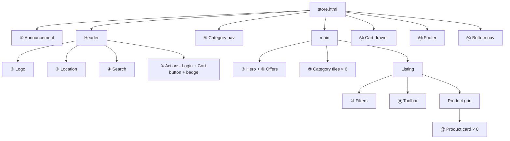

# Build an E-commerce Page: Start Here

<span class="lvl lvl-1">Beginner</span> <span class="lvl lvl-2">Intermediate</span>

In this tab you build **FreshCart**, a responsive grocery store page (think BigBasket, Blinkit or Instacart), one small
component at a time. Every line of code is explained. By the end you have a real page that works on a phone and on a desktop,
with a working cart.

<iframe src="demos/store.html" title="FreshCart: the finished page" style="width:100%;height:640px;border:1px solid var(--md-default-fg-color--lightest);border-radius:12px" loading="lazy"></iframe>

Open it full-size: [store.html](demos/store.html){ target=_blank }. Press ++ctrl+shift+m++ in DevTools to view it as a phone,
click **ADD** on a few products, then open the cart.

## How to start (10 minutes of setup)

You need only a browser and a text editor. No Node, no framework, no build step.

1. **Install an editor.** [VS Code](https://code.visualstudio.com/) is free. Add the **Live Server** extension: it reloads
   the page every time you save.
2. **Create this folder structure.** One CSS file per component keeps every file short and easy to find.

    ```text
    freshcart/
    ├── store.html          ← the page (all the HTML)
    ├── css/
    │   ├── base.css        ← colours, spacing, reset, buttons   (lesson 1)
    │   ├── header.css      ← announcement bar, header, nav     (lesson 2)
    │   ├── home.css        ← hero, offers, category tiles      (lesson 3)
    │   ├── product.css     ← product card + product grid       (lesson 4)
    │   ├── listing.css     ← filters, sort bar, page layout    (lesson 5)
    │   ├── cart.css        ← cart drawer                       (lesson 6)
    │   └── footer.css      ← footer + mobile bottom nav        (lesson 7)
    └── js/
        └── store.js        ← cart, filters and sort            (lessons 4–6)
    ```

3. **Type, don't paste.** Typing each line is slower but you'll remember it. Paste only when you're stuck.
4. **Right-click → Open with Live Server** on `store.html`. Keep DevTools open (++f12++) while you work.
5. **After each lesson**, resize the browser from wide to narrow and check nothing overflows sideways.

!!! tip "Want the finished files?"
    Every file in this tab lives in the repository under
    [`docs/ecommerce/demos/`](https://github.com/khiruashish/web-ui-frontend-playbook/tree/main/docs/ecommerce/demos).
    Download the folder and open `store.html` in a browser. Nothing to install.

## Step 1 before any code: break the page into boxes

Professional frontend developers never start by typing. They look at the design and draw **boxes inside boxes**. Each box becomes
an HTML element; repeated boxes become a **component** (the same HTML + CSS reused). Here is FreshCart broken into its components:

<div class="demo">
<div style="display:grid;gap:6px;font:600 12px/1.3 system-ui;color:#1f2329">
  <div style="background:#1f2329;color:#fff;padding:6px;border-radius:6px;text-align:center">① Announcement bar</div>
  <div style="display:grid;grid-template-columns:auto auto 1fr auto;gap:6px;background:#fff;border:2px solid #0c831f;padding:6px;border-radius:6px">
    <span style="background:#e8f5ea;padding:6px;border-radius:4px">② Logo</span>
    <span style="background:#e8f5ea;padding:6px;border-radius:4px">③ Location</span>
    <span style="background:#e8f5ea;padding:6px;border-radius:4px">④ Search box</span>
    <span style="background:#e8f5ea;padding:6px;border-radius:4px">⑤ Login · Cart (badge)</span>
  </div>
  <div style="background:#fff;border:2px dashed #0c831f;padding:6px;border-radius:6px">⑥ Category nav: All · Fruits · Vegetables · Dairy · … (scrolls sideways on a phone)</div>
  <div style="background:#fff6d8;padding:14px 6px;border-radius:6px">⑦ Hero banner: headline + button + picture</div>
  <div style="display:grid;grid-template-columns:repeat(3,1fr);gap:6px">
    <span style="background:#2563eb;color:#fff;padding:6px;border-radius:6px">⑧ Offer</span>
    <span style="background:#db2777;color:#fff;padding:6px;border-radius:6px">⑧ Offer</span>
    <span style="background:#7c3aed;color:#fff;padding:6px;border-radius:6px">⑧ Offer</span>
  </div>
  <div style="display:grid;grid-template-columns:repeat(6,1fr);gap:6px">
    <span style="background:#e8f5ea;padding:6px;border-radius:50px;text-align:center">⑨</span><span style="background:#e8f5ea;padding:6px;border-radius:50px;text-align:center">⑨</span><span style="background:#e8f5ea;padding:6px;border-radius:50px;text-align:center">⑨</span><span style="background:#e8f5ea;padding:6px;border-radius:50px;text-align:center">⑨</span><span style="background:#e8f5ea;padding:6px;border-radius:50px;text-align:center">⑨</span><span style="background:#e8f5ea;padding:6px;border-radius:50px;text-align:center">⑨</span>
  </div>
  <div style="display:grid;grid-template-columns:1fr 3fr;gap:6px">
    <div style="background:#fff;border:2px solid #f8cb46;padding:6px;border-radius:6px">⑩ Filters sidebar</div>
    <div style="display:grid;gap:6px">
      <div style="background:#fff;border:2px solid #f8cb46;padding:6px;border-radius:6px">⑪ Toolbar: "Showing 8 products" · Sort by</div>
      <div style="display:grid;grid-template-columns:repeat(4,1fr);gap:6px">
        <span style="background:#fff;border:2px solid #d6342c;padding:14px 6px;border-radius:6px">⑫ Product card</span><span style="background:#fff;border:2px solid #d6342c;padding:14px 6px;border-radius:6px">⑫</span><span style="background:#fff;border:2px solid #d6342c;padding:14px 6px;border-radius:6px">⑫</span><span style="background:#fff;border:2px solid #d6342c;padding:14px 6px;border-radius:6px">⑫</span>
      </div>
    </div>
  </div>
  <div style="background:#1f2329;color:#fff;padding:10px 6px;border-radius:6px">⑬ Footer: about · links · newsletter</div>
  <div style="display:flex;gap:6px;align-items:center;font-weight:400"><span style="background:#fff;border:2px dashed #5b6370;padding:6px;border-radius:6px;font-weight:600">⑭ Cart drawer</span> slides in from the right · <span style="background:#fff;border:2px dashed #5b6370;padding:6px;border-radius:6px;font-weight:600">⑮ Bottom nav</span> phones only</div>
</div>
</div>

Each number is one small component. Notice three things:

* **Components repeat.** ⑫ Product card is written once and used eight times. ⑨ Category tile is used six times.
* **Components nest.** The header ⑤ contains the cart button, which contains a red count badge.
* **Each component needs one layout tool.** A row of things → **Flexbox**. A 2-D arrangement or a grid of equal cards → **Grid**.



## Step 2: decide how it changes on a phone

Write the **phone layout first** (one column, everything stacked), then add `@media (width >= 768px)` rules that spread things out
on wider screens. This is called **mobile first**: phones get the simplest CSS, and big screens add to it.

| Component | Phone (< 768 px) | Desktop (≥ 768 px) | Tool |
|---|---|---|---|
| Header | logo · location · cart on row 1, search on row 2 | everything in one row | Grid `grid-template-areas` |
| Category nav | one row that scrolls sideways | one row, fits | Flexbox + `overflow-x: auto` |
| Hero | text only | text left, picture right | Grid columns |
| Offers | swipeable carousel | three equal boxes | Grid + `scroll-snap` |
| Category tiles | 3 per row | as many as fit | Grid `auto-fill` |
| Filters | collapsed "Filters ▸" button | always-open sidebar (≥ 900 px) | `<details>` + Grid |
| Product grid | 2 per row | as many as fit | Grid `auto-fill` + `minmax()` |
| Footer | stacked | 4 columns | Grid `auto-fit` |
| Bottom nav | fixed at the bottom | hidden | `position: fixed` |

## The lessons

| # | Lesson | You learn |
|---|---|---|
| 1 | [Page skeleton & design tokens](01-skeleton.md) | Every line of the HTML boilerplate, a CSS reset, CSS variables, a `.container`, buttons |
| 2 | [Header & category nav](02-header.md) | Sticky header, `grid-template-areas`, a search form, a cart badge, a sideways-scrolling nav |
| 3 | [Hero, offers & category tiles](03-hero-categories.md) | `clamp()` font sizes, gradients, a scroll-snap carousel, an `auto-fill` grid |
| 4 | [Product card & product grid](04-product-card.md) | The most important e-commerce component: badge, price, ADD button, quantity stepper |
| 5 | [Listing: filters & sort](05-listing-filters.md) | Sidebar layout, `<details>`, `<fieldset>`, filtering and sorting with JavaScript |
| 6 | [Cart drawer](06-cart.md) | `<dialog>`, `::backdrop`, cart state, money in paise, event delegation |
| 7 | [Footer & mobile bottom nav](07-footer.md) | Footer grid, newsletter form, `position: fixed`, `:has()`, safe areas |
| 8 | [Put it all together](08-full-page.md) | The assembled page, a testing checklist, and exercises to keep practising |

## How each lesson is laid out

1. **What you see**: the component, live, in a frame you can resize.
2. **HTML**, then a **line-by-line table** explaining every line.
3. **CSS**, then a **line-by-line table**.
4. **Try it** exercises, each with a collapsed **solution** to open after you've had a go, and **common mistakes**.
   The code solutions all run together in [store-solved.html](demos/store-solved.html){ target=_blank }.

All code on these pages is pulled straight from the files in `demos/`, so what you read is exactly what runs in the frames.
The `<!-- --8<-- [start:…] -->` comments you'll see in those files are only markers that tell this site which piece to show.
You don't need them in your own copy.

!!! note "Why emoji instead of product photos?"
    So the demo has no image files to download. In a real store each product picture is an ``; lesson 4 shows exactly how
    to write it (`width`, `height`, `alt`, `loading="lazy"`).
