# Document Structure & Metadata

## The minimum valid page <span class="lvl lvl-1">Beginner</span> { #the-minimum-valid-page data-toc-label="The minimum valid page" }

Learn this skeleton by heart. Every page you build starts here.

```html
<!doctype html>
<html lang="en">
<head>
  <meta charset="utf-8">
  <meta name="viewport" content="width=device-width, initial-scale=1">
  <title>My first page</title>
  <link rel="stylesheet" href="styles.css">
</head>
<body>
  <h1>Hello</h1>
</body>
</html>
```

| Line | Why it's there |
|---|---|
| `<!doctype html>` | Tells the browser to use standards mode. Without it you get "quirks mode", which emulates 1990s browser bugs. |
| `<html lang="en">` | Root element. `lang` sets pronunciation for screen readers, hyphenation, spell-check and translation. |
| `<meta charset="utf-8">` | Character encoding. Must be in the first 1024 bytes. Without it, characters like é or ₹ can turn into `é`. |
| `<meta name="viewport" …>` | Makes mobile browsers use the device width instead of pretending to be 980px wide. **Without it, responsive design doesn't work.** |
| `<title>` | Shown in the browser tab, bookmarks and search results. Required. |

## `<!doctype html>` <span class="lvl lvl-1">Beginner</span> { #doctype-html data-toc-label="&lt;!doctype html&gt;" }

**Use:** switches the browser into standards mode. Not an element, it's a declaration. Case-insensitive.

## `<html>` <span class="lvl lvl-1">Beginner</span> { #html data-toc-label="&lt;html&gt;" }

**Use:** the root of the document. Everything else goes inside it.

**Key attributes:** `lang` (always set it), `dir="rtl"` for right-to-left languages such as Arabic and Hebrew.

## `<head>` <span class="lvl lvl-1">Beginner</span> { #head data-toc-label="&lt;head&gt;" }

**Use:** a container for metadata: things about the page, not shown in the page. Contains `title`, `meta`, `link`, `style`, `script`, `base`, `noscript`, `template`.

## `<title>` <span class="lvl lvl-1">Beginner</span> { #title data-toc-label="&lt;title&gt;" }

```html
<title>Pricing · Acme Cloud</title>
```

**Use:** the document's name. Put the specific part first ("Pricing") and the brand last, so tabs stay readable when they're narrow.

## `<meta>` <span class="lvl lvl-1">Beginner</span> { #meta data-toc-label="&lt;meta&gt;" }

**Use:** metadata that has no dedicated element.

```html
<meta charset="utf-8">
<meta name="viewport" content="width=device-width, initial-scale=1">
<meta name="description" content="Simple, predictable pricing for teams of any size.">
<meta name="theme-color" content="#e4572e">
<meta name="color-scheme" content="light dark">
<meta name="robots" content="index, follow">

<!-- Open Graph: link previews in Slack, WhatsApp, LinkedIn, etc. -->
<meta property="og:title" content="Acme Cloud Pricing">
<meta property="og:description" content="Simple, predictable pricing.">
<meta property="og:image" content="https://acme.example/og.png">
<meta property="og:url" content="https://acme.example/pricing">
<meta name="twitter:card" content="summary_large_image">
```

| `name` / `property` | What it does |
|---|---|
| `viewport` | Mobile layout width. Never add `user-scalable=no` or `maximum-scale=1`: they block zoom, which fails WCAG. |
| `description` | Snippet text in search results (~155 characters). |
| `theme-color` | Colours the browser UI on mobile. Accepts a `media` attribute for light/dark values. |
| `color-scheme` | Tells the browser your page supports dark mode, so form controls and scrollbars adapt before CSS loads. |
| `robots` | Search engine indexing rules. |
| `og:*`, `twitter:*` | Social preview cards. |

!!! tip "Senior note · 🟠 Advanced"
    `http-equiv` meta tags act like HTTP headers (`Content-Security-Policy`, `refresh`). Prefer real HTTP headers: they apply before parsing and some directives (like CSP's `frame-ancestors`) are ignored in meta form.

## `<link>` <span class="lvl lvl-1">Beginner</span> → <span class="lvl lvl-3">Advanced</span> { #link data-toc-label="&lt;link&gt;" }

**Use:** connects the page to external resources.

```html
<link rel="stylesheet" href="/css/main.css">
<link rel="icon" href="/favicon.svg" type="image/svg+xml">
<link rel="apple-touch-icon" href="/apple-touch-icon.png">
<link rel="manifest" href="/site.webmanifest">
<link rel="canonical" href="https://acme.example/pricing">

<!-- Performance hints -->
<link rel="preconnect" href="https://fonts.gstatic.com" crossorigin>
<link rel="preload" href="/fonts/inter.woff2" as="font" type="font/woff2" crossorigin>
<link rel="preload" href="/hero.avif" as="image" fetchpriority="high">
<link rel="modulepreload" href="/js/app.js">
<link rel="dns-prefetch" href="https://cdn.example.com">

<!-- Print-only stylesheet -->
<link rel="stylesheet" href="/css/print.css" media="print">
```

| `rel` | Use |
|---|---|
| `stylesheet` | Load CSS. Blocks rendering until loaded (that's on purpose). |
| `icon` | Favicon. SVG favicons can include a `prefers-color-scheme` media query. |
| `manifest` | Web app manifest for installable PWAs. |
| `canonical` | The preferred URL for duplicate content (SEO). |
| `preconnect` | Open a connection to another origin early. Use for 1–3 critical origins only. |
| `preload` | Fetch a resource you *will* need on this page, now, with high priority. |
| `modulepreload` | Preload a JS module and its parse. |
| `prefetch` | Fetch a resource the *next* page might need, at low priority. |
| `alternate` | Alternate versions: `hreflang` translations, RSS feeds. |

## `<style>` <span class="lvl lvl-1">Beginner</span> { #style data-toc-label="&lt;style&gt;" }

**Use:** CSS inside the HTML document.

```html
<style>
  body { font-family: system-ui, sans-serif; }
</style>
```

!!! tip "Senior note · 🟠 Advanced"
    Inlining the **critical CSS** (what's needed for the first screen) in a `<style>` tag and loading the rest async can noticeably improve LCP. Don't inline everything; you lose browser caching across pages.

## `<script>` <span class="lvl lvl-1">Beginner</span> → <span class="lvl lvl-3">Advanced</span> { #script data-toc-label="&lt;script&gt;" }

**Use:** runs JavaScript, or holds data (`type="application/ld+json"`, `type="importmap"`).

```html
<!-- Classic script: blocks HTML parsing while it downloads and runs -->
<script src="legacy.js"></script>

<!-- defer: download in parallel, run in order after HTML is parsed -->
<script src="app.js" defer></script>

<!-- async: download in parallel, run as soon as it arrives (any order) -->
<script src="analytics.js" async></script>

<!-- module: deferred by default, strict mode, supports import/export -->
<script type="module" src="main.js"></script>

<!-- import map: name bare imports -->
<script type="importmap">
  { "imports": { "lit": "https://cdn.jsdelivr.net/npm/lit@3/+esm" } }
</script>

<!-- Structured data for search engines -->
<script type="application/ld+json">
  { "@context": "https://schema.org", "@type": "Organization", "name": "Acme" }
</script>
```



```mermaid
gantt
    dateFormat X
    axisFormat %s
    section Plain script
    Parse HTML  :0, 3
    Download    :3, 5
    Execute     :5, 6
    Parse rest  :6, 9
    section defer
    Parse HTML  :0, 9
    Download    :1, 4
    Execute     :9, 10
    section async
    Parse HTML  :0, 4
    Download    :1, 4
    Execute     :4, 5
    Parse rest  :5, 9
```

**Rule of thumb:** use `type="module"` or `defer` for your app code. Use `async` only for independent scripts like analytics.

## `<noscript>` <span class="lvl lvl-2">Intermediate</span> { #noscript data-toc-label="&lt;noscript&gt;" }

**Use:** content shown only when JavaScript is disabled.

```html
<noscript>
  <p>This app needs JavaScript. Here's a <a href="/basic">basic version</a>.</p>
</noscript>
```

## `<base>` <span class="lvl lvl-3">Advanced</span> { #base data-toc-label="&lt;base&gt;" }

**Use:** sets the base URL for every relative URL in the document. Only one per page.

```html
<base href="https://docs.example.com/v2/">
```

!!! warning
    `<base>` also changes where `#anchor` links point. `<a href="#top">` becomes `https://docs.example.com/v2/#top`, which can break in-page navigation. Avoid it unless you need it.

## `<body>` <span class="lvl lvl-1">Beginner</span> { #body data-toc-label="&lt;body&gt;" }

**Use:** contains everything visible on the page. One per document.

!!! tip "Senior note · 🔴 Expert"
    The browser builds the DOM top to bottom. Stylesheets in `<head>` block rendering; scripts without `defer`/`async` block parsing. A good `<head>` order: `charset` → `viewport` → `title` → `preconnect` → critical CSS → `preload` → stylesheets → deferred scripts → SEO and social meta. Tools like `capo.js` check this ordering for you.
