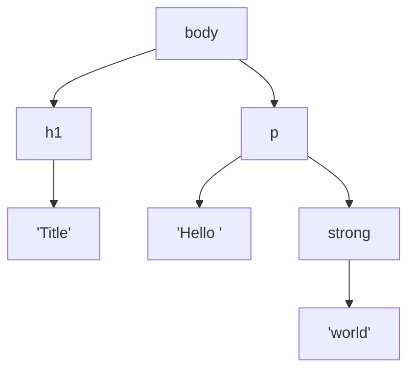

# HTML5: How It Works

HTML (HyperText Markup Language) describes **what content is**: a heading, a paragraph, a button, a navigation menu. CSS then describes **how it looks**, and JavaScript describes **how it behaves**.

!!! info "What “HTML5” means today"
    "HTML5" was the 2014 W3C snapshot. Since 2019 there's one HTML standard, the **HTML Living Standard** maintained by WHATWG, and it changes continuously. When people say HTML5 today, they mean "modern HTML". This playbook follows the Living Standard as of 2026.

## Elements, tags and attributes <span class="lvl lvl-1">Beginner</span> { #elements-tags-and-attributes data-toc-label="Elements, tags and attributes" }

```html
<a href="https://example.com" target="_blank">Visit example</a>
```

| Part | In the example | Meaning |
|---|---|---|
| **Opening tag** | `<a …>` | Starts the element |
| **Attribute** | `href="https://example.com"` | Extra information: name + value |
| **Content** | `Visit example` | What's inside |
| **Closing tag** | `</a>` | Ends the element |
| **Element** | the whole thing | Opening tag + content + closing tag |

<div class="demo">
<a href="https://example.com" target="_blank" rel="noopener">Visit example</a>
</div>

**Void elements** have no content and no closing tag: `<br>`, `<hr>`, ``, `<input>`, `<meta>`, `<link>`, `<source>`, `<track>`, `<wbr>`, `<area>`, `<base>`, `<col>`, `<embed>`. Writing `<br/>` with a slash is allowed but has no effect in HTML.

**Boolean attributes** are on when present and off when absent: `<input disabled>`. Writing `disabled="false"` still disables it.

## The DOM <span class="lvl lvl-1">Beginner</span> { #the-dom data-toc-label="The DOM" }

The browser reads your HTML and builds a tree of objects called the **DOM** (Document Object Model). CSS styles the DOM and JavaScript changes it.

```html
<body>
  <h1>Title</h1>
  <p>Hello <strong>world</strong></p>
</body>
```



## Block vs inline <span class="lvl lvl-1">Beginner</span> { #block-vs-inline data-toc-label="Block vs inline" }

By default, each element has a CSS `display` value.

- **Block** elements (`<div>`, `<p>`, `<h1>`, `<section>`, `<ul>`) start on a new line and stretch to fill the width.
- **Inline** elements (`<span>`, `<a>`, `<strong>`, `<em>`, `<code>`) sit inside a line of text and are only as wide as their content.

```html
<div style="background:#ffd8c2">I'm a block div</div>
<div style="background:#c7e2ff">So am I, on a new line</div>
<span style="background:#ffd8c2">I'm inline</span>
<span style="background:#c7e2ff">I sit on the same line</span>
```

<div class="demo">
<div style="background:#ffd8c2;color:#222">I'm a block div</div>
<div style="background:#c7e2ff;color:#222">So am I, on a new line</div>
<span style="background:#ffd8c2;color:#222">I'm inline</span>
<span style="background:#c7e2ff;color:#222">I sit on the same line</span>
</div>

!!! tip "Senior note · 🟡 Intermediate"
    "Block" and "inline" are CSS behaviours, not HTML rules. The HTML spec uses **content categories** instead: flow, phrasing, heading, sectioning, embedded, interactive, metadata. These decide what can be nested inside what. For example, `<p>` accepts only *phrasing content*, so `<p><div>…</div></p>` is invalid; the browser closes the `<p>` before the `<div>`.

## Content categories <span class="lvl lvl-2">Intermediate</span> { #content-categories data-toc-label="Content categories" }

| Category | Examples | What it means |
|---|---|---|
| Metadata | `title`, `meta`, `link`, `style`, `script`, `base` | Describes the document; lives in `<head>` |
| Flow | almost everything in `<body>` | Allowed wherever body content is allowed |
| Sectioning | `article`, `aside`, `nav`, `section` | Defines a section with its own heading scope |
| Heading | `h1`–`h6`, `hgroup` | Section titles |
| Phrasing | `span`, `a`, `em`, `strong`, `img`, `input` | Text-level content inside paragraphs |
| Embedded | `img`, `video`, `audio`, `iframe`, `svg`, `canvas` | Imports another resource |
| Interactive | `a[href]`, `button`, `input`, `select`, `details`, `label` | The user can interact with it |

Rule of thumb: **interactive content can't be nested inside interactive content.** A `<button>` inside an `<a>` is invalid and confuses screen readers and keyboards.

## Semantic HTML: why it matters <span class="lvl lvl-1">Beginner</span> { #semantic-html-why-it-matters data-toc-label="Semantic HTML: why it matters" }

```html
<!-- ❌ Div soup -->
<div class="header"><div class="nav">…</div></div>
<div class="button" onclick="save()">Save</div>

<!-- ✅ Semantic -->
<header><nav>…</nav></header>
<button type="button" onclick="save()">Save</button>
```

The semantic version gives you, for free:

- **Keyboard support**: `<button>` is focusable and responds to ++enter++ and ++space++.
- **Screen reader support**: announced as "Save, button"; landmarks let users jump to the nav.
- **SEO**: search engines understand page structure.
- **Less code**: no `tabindex`, `role` or key handlers to write and maintain.

## Validate your HTML <span class="lvl lvl-2">Intermediate</span> { #validate-your-html data-toc-label="Validate your HTML" }

- [W3C Nu HTML Checker](https://validator.w3.org/nu/) catches nesting errors and invalid attributes.
- In CI, run `html-validate` or `vnu-jar` on built pages.
- Browsers silently fix bad HTML, but each browser can fix it differently. Valid HTML gives a predictable DOM.

## Pages in this section

| Page | Elements |
|---|---|
| [Document Structure & Metadata](document-structure.md) | `html`, `head`, `title`, `meta`, `link`, `style`, `script`, `noscript`, `base`, `body` |
| [Text Content](text-content.md) | `h1`–`h6`, `p`, `br`, `hr`, `pre`, `blockquote`, lists, `div`, `figure` |
| [Inline Text Semantics](inline-semantics.md) | `a`, `strong`, `em`, `mark`, `code`, `kbd`, `abbr`, `time`, `ruby`… |
| [Sectioning & Landmarks](sectioning.md) | `header`, `nav`, `main`, `article`, `section`, `aside`, `footer`, `search`… |
| [Images & Media](media.md) | `img`, `picture`, `video`, `audio`, `iframe`, `svg`, `canvas`… |
| [Tables](tables.md) | `table`, `caption`, `thead`, `tbody`, `tr`, `th`, `td`, `colgroup`… |
| [Forms & Inputs](forms.md) | `form`, all 22 `input` types, `select`, `textarea`, `meter`… |
| [Interactive & Web Components](interactive.md) | `details`, `dialog`, popover, `template`, `slot` |
| [Global Attributes](global-attributes.md) | `id`, `class`, `data-*`, `aria-*`, `hidden`, `inert`… |
| [A–Z Tag Reference](all-tags.md) | Every element in one table, plus deprecated tags |
