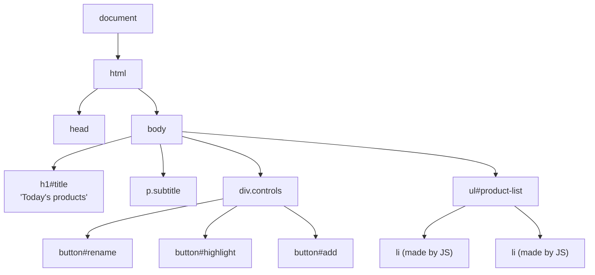

# 6. The DOM: Changing the Page

<span class="lvl lvl-1">Beginner</span> <span class="lvl lvl-2">Intermediate</span>

When the browser reads your HTML, it builds a tree of objects called the **DOM** (Document Object Model). Each tag becomes an
object you can find, read and change from JavaScript. Change the DOM and the browser redraws the page.



## What you see

<iframe src="../demos/06-dom.html" title="DOM basics: live demo" style="width:100%;height:360px;border:1px solid var(--md-default-fg-color--lightest);border-radius:12px" loading="lazy"></iframe>

Click the three buttons. Open it full-size: [06-dom.html](demos/06-dom.html){ target=_blank }, then press ++f12++ and look at the
**Elements** panel: the `<li>`s aren't in the HTML file; JavaScript created them.

## The HTML

```html
--8<-- "docs/javascript/demos/06-dom.html:html"
```

The list `<ul id="product-list">` is **empty**. JavaScript fills it from an array: the same way a real store fills its pages from
data sent by the server.

## 1. Find elements

```js
--8<-- "docs/javascript/demos/06-dom.html:select"
```

| Code | What it does |
|---|---|
| `document` | The whole page. The starting point for everything. |
| `document.querySelector("#title")` | Finds the **first** element matching a CSS selector (`#id`, `.class`, `tag`, `[data-x]`, `nav a`…). Gives `null` if nothing matches. |
| `document.querySelectorAll(".controls button")` | Finds **all** matches, as a `NodeList`. You can loop over it with `for…of`; use `[...list]` for array methods like `map`. |
| `buttons.length` | How many were found: `3`. |

You can also search **inside** an element: `list.querySelectorAll("li")` only looks within the list.

## 2. Build elements from data

```js
--8<-- "docs/javascript/demos/06-dom.html:render"
```

| Code | What it does |
|---|---|
| `const products = [ … ];` | The data, as an array of objects (lesson 4). |
| `function renderProduct(product)` | A small function: **one product in, one `<li>` out**. Reusable for the first render and for adding later. |
| `document.createElement("li")` | Makes a new, empty `<li>`. It isn't on the page until you insert it. |
| `li.dataset.price = product.pricePaise;` | Sets `data-price="18900"`. `dataset.someName` ↔ `data-some-name`. |
| `name.textContent = product.name;` | Sets the text. `textContent` treats everything as plain text, so data can never inject HTML. |
| `price.className = "price";` | Sets the `class` attribute (for the CSS rule `.price { font-weight: 700 }`). |
| `li.append(name, price);` | Puts both spans inside the `<li>`, in order. |
| `list.append(...products.map(renderProduct));` | `map` turns 3 products into 3 `<li>`s; spread passes them all to `append` in one go. One DOM update is faster than three. |

!!! danger "`innerHTML` with data is a security hole"
    `li.innerHTML = product.name` would run any HTML inside the name. If a name ever came from a user or a server, someone could
    insert ``. This is called **XSS** (cross-site scripting). Use `textContent` for data, and
    keep `innerHTML` for fixed markup you wrote yourself.

## 3. Change what's on the page

```js
--8<-- "docs/javascript/demos/06-dom.html:change"
```

| Code | What it does |
|---|---|
| `addEventListener("click", () => { … })` | Run this function when the button is clicked (lesson 7 covers events). |
| `title.textContent = "Fresh picks for you";` | Replaces the heading's text. |
| `title.style.color = "#0c831f";` | Sets one inline style. Fine for one-offs; for anything bigger, toggle a **class** and keep the styling in CSS. |
| `list.querySelectorAll("li")` | Only the `<li>`s inside the list. |
| `Number(li.dataset.price) < 10000` | Data attributes are strings; convert before comparing (lesson 1). |
| `li.classList.toggle("highlight", cheap)` | Adds the class when `cheap` is true, removes it when false. Also: `classList.add()`, `.remove()`, `.contains()`. |
| `list.prepend(…)` | Inserts at the **start** of the list (`append` = end; `before`/`after` = next to an element). |
| `event.currentTarget` | The element the listener is attached to: here, the clicked button. |
| `.disabled = true` | Many attributes have matching properties: `disabled`, `hidden`, `value`, `checked`, `href`. For any other attribute use `setAttribute("aria-label", "…")` / `getAttribute(…)`. |

## Cheat sheet

| Task | Code |
|---|---|
| Find one / all | `document.querySelector(sel)` / `document.querySelectorAll(sel)` |
| Nearest ancestor matching | `el.closest(".product-card")` |
| Read / change text | `el.textContent` |
| Read an input | `input.value` (always a string) |
| Classes | `el.classList.add / remove / toggle / contains("name")` |
| Attributes | `el.getAttribute("x")`, `el.setAttribute("x", "y")`, `el.removeAttribute("x")` |
| Data attributes | `el.dataset.productId` ↔ `data-product-id` |
| Show / hide | `el.hidden = true / false` |
| Create | `document.createElement("li")` |
| Insert | `parent.append(child)`, `parent.prepend(child)`, `el.before(x)`, `el.after(x)` |
| Replace all children | `parent.replaceChildren(...newChildren)` |
| Remove | `el.remove()` |

## Try it

1. Add a fourth button "Sort by price" that re-appends the `<li>`s in price order (hint: `[...list.children]`, `toSorted`,
   `list.append(...)`).
2. Give each `<li>` a "×" button that removes it.
3. Show the total of all prices in a `<p>` under the list, and update it when a product is added.

## Common mistakes

* Running the script before the HTML exists, so `querySelector` returns `null`. Use `<script defer>` or put the script at the
  end of `<body>`.
* `querySelector("product-list")` without `#` or `.`: that searches for a `<product-list>` **tag**.
* Calling `.forEach` or `.map` on something that isn't an array. `querySelectorAll` has `forEach` but not `map`: spread it first.
* Building HTML strings with data and `innerHTML` (XSS).
