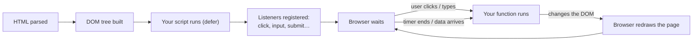

# JavaScript Basics: Start Here

<span class="lvl lvl-1">Beginner</span>

HTML is the **content** of a page, CSS is how it **looks**, and JavaScript is how it **behaves**: what happens when you click
"ADD", type in a search box, or wait for products to load. This tab teaches the JavaScript you need for frontend work, from
your first line to `fetch()`, using one running example: the FreshCart grocery store from the
[E-commerce Page](../ecommerce/index.md) tab.

## How to run JavaScript (pick one)

=== "Browser console (fastest)"

    1. Open any page in Chrome, Edge or Firefox.
    2. Press ++f12++ (++cmd+opt+j++ on macOS) and click the **Console** tab.
    3. Type `console.log("Hello")` and press ++enter++.

    Perfect for trying one-liners. Paste any example from this tab and press ++enter++.

=== "A .html file (how websites do it)"

    Create `hello.html`, open it in the browser, and look at the console (++f12++):

    ```html
    <!doctype html>
    <html lang="en">
    <head>
      <meta charset="utf-8">
      <title>Hello JS</title>
      <script src="app.js" defer></script>   <!-- defer: run after the HTML is ready -->
    </head>
    <body>
      <h1>Open the console</h1>
    </body>
    </html>
    ```

    ```js title="app.js"
    console.log("Hello from app.js");
    document.querySelector("h1").textContent = "JavaScript changed this heading";
    ```

=== "Node.js (no browser)"

    Install [Node.js](https://nodejs.org/) (the LTS version), save code as `hello.js`, then in a terminal:

    ```bash
    node hello.js
    ```

    Good for practising the language itself. Node has no `document`, so lessons 6–8's page examples need a browser.

## How each lesson is laid out

1. A short explanation of **what** and **why**.
2. The **code**, then its **console output** right underneath.
3. A **line-by-line** table for the lines that matter.
4. **Try it** exercises and **common mistakes**.

!!! success "Every output on these pages is real"
    The code lives in [`docs/javascript/examples/`](https://github.com/khiruashish/web-ui-frontend-playbook/tree/main/docs/javascript/examples),
    and [`javascript/run-examples.mjs`](https://github.com/khiruashish/web-ui-frontend-playbook/blob/main/javascript/run-examples.mjs)
    runs every example and saves what it prints. CI fails if an output on the site no longer matches the code. The page demos
    (lessons 6–8) are clicked through in a real browser by Playwright on every change.

!!! note "Console output: browser vs this site"
    Outputs here come from Node.js. Your browser's console shows the **same values**, but draws objects and arrays as
    expandable trees (`▶ {name: 'Apple'}`) instead of text. Error messages can also be worded slightly differently between
    browsers.

## The lessons

| # | Lesson | You learn |
|---|---|---|
| 1 | [Variables, Types & Strings](01-variables.md) | `const`/`let`, the 7 basic types, template literals, why money is stored in paise, converting `"3"` to `3` |
| 2 | [Operators & Decisions](02-conditions.md) | `===`, `&&` `||` `!`, truthy/falsy, `??` and `?.`, `if`/`else`, the ternary, `switch` |
| 3 | [Functions](03-functions.md) | Declarations and arrow functions, defaults, `return`, scope, callbacks, closures |
| 4 | [Arrays & Objects](04-arrays-objects.md) | Lists and records, destructuring, spread, references vs copies, `Map`, `Set`, JSON |
| 5 | [Loops & Array Methods](05-loops.md) | `for`, `for…of`, `map`, `filter`, `find`, `reduce`, sorting, and a full cart bill |
| 6 | [The DOM: Changing the Page](06-dom.md) | Finding elements, changing text, classes and attributes, building elements from data |
| 7 | [Events: Reacting to Users](07-events.md) | Clicks, typing, forms, keyboard, event delegation |
| 8 | [Async: Timers, Promises & fetch](08-async.md) | Why JS doesn't wait, promises, `async`/`await`, `try`/`catch`, loading data from a server |
| 9 | [Errors, Debugging & Good Habits](09-errors.md) | Reading error messages, `throw`, DevTools breakpoints, modules, clean-code habits |

After lesson 9, rebuild the FreshCart cart in [E-commerce lesson 6](../ecommerce/06-cart.md): every line of its JavaScript
uses only what this tab teaches.

## How JavaScript runs, in one picture



Your script runs once at the start and **sets things up**. After that, almost all your code runs **in response to events**:
a click, a keystroke, a timer, or data arriving from the server.
