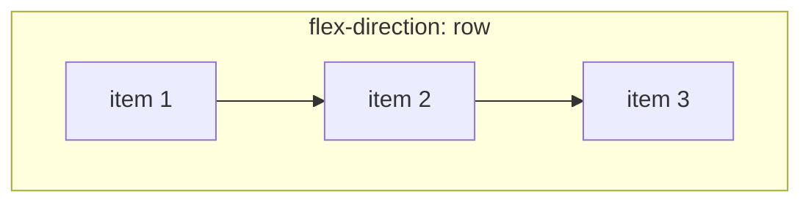

# Flexbox (complete reference)

Flexbox lays items out along **one axis**. In every demo, the dashed orange box is the **flex container** and the coloured boxes are **flex items**.

## The two axes <span class="lvl lvl-1">Beginner</span> { #the-two-axes data-toc-label="The two axes" }



- **Main axis**: the direction items flow (`row` = left→right; `column` = top→bottom). `justify-content` works on this axis.
- **Cross axis**: perpendicular to it. `align-items` works on this axis.

When you switch to `flex-direction: column`, the axes swap, so `justify-content` becomes vertical.

## `display: flex` <span class="lvl lvl-1">Beginner</span> { #display-flex data-toc-label="display: flex" }

```html
<div class="container">
  <div>1</div><div>2</div><div>3</div>
</div>
```

```css
.container { display: flex; }
```

<div class="demo">
<div class="c" style="display:flex"><div class="b">1</div><div class="b">2</div><div class="b">3</div></div>
</div>

Children become flex items: they sit in a row, shrink to fit their content, and stretch to the container's height. `display: inline-flex` does the same but the container itself flows inline.

## Container properties

### `flex-direction` <span class="lvl lvl-1">Beginner</span> { #flex-direction data-toc-label="flex-direction" }

```css
flex-direction: row;            /* default */
flex-direction: row-reverse;
flex-direction: column;
flex-direction: column-reverse;
```

<div class="demo">
<div style="display:grid;grid-template-columns:repeat(auto-fit,minmax(150px,1fr));gap:1em">
<div><code>row</code><div class="c" style="display:flex;flex-direction:row"><div class="b">1</div><div class="b">2</div><div class="b">3</div></div></div>
<div><code>row-reverse</code><div class="c" style="display:flex;flex-direction:row-reverse"><div class="b">1</div><div class="b">2</div><div class="b">3</div></div></div>
<div><code>column</code><div class="c" style="display:flex;flex-direction:column"><div class="b">1</div><div class="b">2</div><div class="b">3</div></div></div>
<div><code>column-reverse</code><div class="c" style="display:flex;flex-direction:column-reverse"><div class="b">1</div><div class="b">2</div><div class="b">3</div></div></div>
</div>
</div>

!!! warning "Accessibility · 🟠 Advanced"
    `*-reverse` and `order` change only the **visual** order. Keyboard tab order and screen readers still follow the HTML source order. If the visual and DOM orders disagree, keyboard users see focus jump around. Change the HTML order instead when the order matters.

### `flex-wrap` <span class="lvl lvl-1">Beginner</span> { #flex-wrap data-toc-label="flex-wrap" }

```css
flex-wrap: nowrap;        /* default: items shrink, then overflow */
flex-wrap: wrap;          /* items move to new lines */
flex-wrap: wrap-reverse;  /* new lines go above */
```

<div class="demo">
<code>nowrap</code>
<div class="c" style="display:flex;flex-wrap:nowrap;max-width:360px"><div class="b" style="width:110px;flex-shrink:0">1</div><div class="b" style="width:110px;flex-shrink:0">2</div><div class="b" style="width:110px;flex-shrink:0">3</div><div class="b" style="width:110px;flex-shrink:0">4</div></div>
<br><code>wrap</code>
<div class="c" style="display:flex;flex-wrap:wrap;max-width:360px"><div class="b" style="width:110px">1</div><div class="b" style="width:110px">2</div><div class="b" style="width:110px">3</div><div class="b" style="width:110px">4</div></div>
<br><code>wrap-reverse</code>
<div class="c" style="display:flex;flex-wrap:wrap-reverse;max-width:360px"><div class="b" style="width:110px">1</div><div class="b" style="width:110px">2</div><div class="b" style="width:110px">3</div><div class="b" style="width:110px">4</div></div>
</div>

(The `nowrap` demo uses `flex-shrink: 0` so you can see the overflow.)

`flex-flow: row wrap;` is the shorthand for `flex-direction` + `flex-wrap`.

### `justify-content` (main axis) <span class="lvl lvl-1">Beginner</span> { #justify-content-main-axis data-toc-label="justify-content (main axis)" }

```css
justify-content: flex-start;    /* default */
justify-content: center;
justify-content: flex-end;
justify-content: space-between; /* first & last at the edges, equal space between */
justify-content: space-around;  /* equal space around each item (half at edges) */
justify-content: space-evenly;  /* exactly equal spaces, including edges */
```

<div class="demo">
<div style="display:grid;gap:.7em">
<div><code>flex-start</code><div class="c" style="display:flex;justify-content:flex-start"><div class="b">1</div><div class="b">2</div><div class="b">3</div></div></div>
<div><code>center</code><div class="c" style="display:flex;justify-content:center"><div class="b">1</div><div class="b">2</div><div class="b">3</div></div></div>
<div><code>flex-end</code><div class="c" style="display:flex;justify-content:flex-end"><div class="b">1</div><div class="b">2</div><div class="b">3</div></div></div>
<div><code>space-between</code><div class="c" style="display:flex;justify-content:space-between"><div class="b">1</div><div class="b">2</div><div class="b">3</div></div></div>
<div><code>space-around</code><div class="c" style="display:flex;justify-content:space-around;gap:0"><div class="b">1</div><div class="b">2</div><div class="b">3</div></div></div>
<div><code>space-evenly</code><div class="c" style="display:flex;justify-content:space-evenly;gap:0"><div class="b">1</div><div class="b">2</div><div class="b">3</div></div></div>
</div>
</div>

### `align-items` (cross axis) <span class="lvl lvl-1">Beginner</span> { #align-items-cross-axis data-toc-label="align-items (cross axis)" }

```css
align-items: stretch;     /* default: items fill the container's height */
align-items: flex-start;
align-items: center;
align-items: flex-end;
align-items: baseline;    /* text baselines line up */
```

<div class="demo">
<div style="display:grid;grid-template-columns:repeat(auto-fit,minmax(170px,1fr));gap:1em">
<div><code>stretch</code><div class="c" style="display:flex;align-items:stretch;height:110px"><div class="b">1</div><div class="b" style="padding-block:1.2em">2</div><div class="b">3</div></div></div>
<div><code>flex-start</code><div class="c" style="display:flex;align-items:flex-start;height:110px"><div class="b">1</div><div class="b" style="padding-block:1.2em">2</div><div class="b">3</div></div></div>
<div><code>center</code><div class="c" style="display:flex;align-items:center;height:110px"><div class="b">1</div><div class="b" style="padding-block:1.2em">2</div><div class="b">3</div></div></div>
<div><code>flex-end</code><div class="c" style="display:flex;align-items:flex-end;height:110px"><div class="b">1</div><div class="b" style="padding-block:1.2em">2</div><div class="b">3</div></div></div>
<div><code>baseline</code><div class="c" style="display:flex;align-items:baseline;height:110px"><div class="b" style="font-size:.8em">small</div><div class="b" style="font-size:1.6em">Big</div><div class="b">mid</div></div></div>
</div>
</div>

### `align-content` (multiple lines) <span class="lvl lvl-2">Intermediate</span> { #align-content-multiple-lines data-toc-label="align-content (multiple lines)" }

Only has an effect when items **wrap** onto several lines and the container has spare cross-axis space. Same values as `justify-content`, plus `stretch`.

```css
.container { display: flex; flex-wrap: wrap; height: 200px; align-content: space-between; }
```

<div class="demo">
<div style="display:grid;grid-template-columns:repeat(auto-fit,minmax(170px,1fr));gap:1em">
<div><code>stretch</code> (default)<div class="c" style="display:flex;flex-wrap:wrap;height:170px;align-content:stretch"><div class="b" style="width:40%">1</div><div class="b" style="width:40%">2</div><div class="b" style="width:40%">3</div><div class="b" style="width:40%">4</div></div></div>
<div><code>flex-start</code><div class="c" style="display:flex;flex-wrap:wrap;height:170px;align-content:flex-start"><div class="b" style="width:40%">1</div><div class="b" style="width:40%">2</div><div class="b" style="width:40%">3</div><div class="b" style="width:40%">4</div></div></div>
<div><code>center</code><div class="c" style="display:flex;flex-wrap:wrap;height:170px;align-content:center"><div class="b" style="width:40%">1</div><div class="b" style="width:40%">2</div><div class="b" style="width:40%">3</div><div class="b" style="width:40%">4</div></div></div>
<div><code>space-between</code><div class="c" style="display:flex;flex-wrap:wrap;height:170px;align-content:space-between"><div class="b" style="width:40%">1</div><div class="b" style="width:40%">2</div><div class="b" style="width:40%">3</div><div class="b" style="width:40%">4</div></div></div>
</div>
</div>

### `gap` <span class="lvl lvl-1">Beginner</span> { #gap data-toc-label="gap" }

```css
gap: 1rem;          /* row-gap and column-gap */
gap: 2rem 0.5rem;   /* row-gap column-gap */
```

<div class="demo">
<div class="c" style="display:flex;flex-wrap:wrap;gap:1.2rem .3rem;max-width:300px"><div class="b" style="width:80px">1</div><div class="b" style="width:80px">2</div><div class="b" style="width:80px">3</div><div class="b" style="width:80px">4</div><div class="b" style="width:80px">5</div></div>
</div>

Always prefer `gap` over margins on items: no "remove the margin from the last item" hacks.

## Item properties

### `flex-grow` <span class="lvl lvl-1">Beginner</span> { #flex-grow data-toc-label="flex-grow" }

How much of the **leftover** space an item takes, as a proportion.

```css
.a { flex-grow: 0; }   /* default: don't grow */
.b { flex-grow: 1; }   /* takes 1 share */
.c { flex-grow: 2; }   /* takes 2 shares */
```

<div class="demo">
<div class="c" style="display:flex"><div class="b" style="flex-grow:0">grow 0</div><div class="b" style="flex-grow:1">grow 1</div><div class="b" style="flex-grow:2">grow 2</div></div>
</div>

Item 3 gets twice as much of the *extra* space as item 2. It's not twice as wide overall; the shares are added on top of each item's base size.

### `flex-shrink` <span class="lvl lvl-2">Intermediate</span> { #flex-shrink data-toc-label="flex-shrink" }

How much an item gives up when there **isn't enough** space. Default `1` (all shrink equally, weighted by size). `0` = never shrink.

```css
.logo   { flex-shrink: 0; }   /* never squash the logo */
.title  { flex-shrink: 1; }
```

<div class="demo">
<div class="c" style="display:flex;max-width:340px"><div class="b" style="flex:0 0 160px">shrink 0 (160px)</div><div class="b" style="flex:0 1 160px">shrink 1</div><div class="b" style="flex:0 3 160px">shrink 3</div></div>
</div>

### `flex-basis` <span class="lvl lvl-1">Beginner</span> { #flex-basis data-toc-label="flex-basis" }

The item's starting size **before** growing or shrinking. `auto` (default) = use `width` or content size. `0` = ignore content size, so space is split purely by `flex-grow`.

<div class="demo">
<code>flex: 1 1 auto</code>: extra space shared, but long content stays wider
<div class="c" style="display:flex"><div class="b" style="flex:1 1 auto">A</div><div class="b" style="flex:1 1 auto">A longer item</div><div class="b" style="flex:1 1 auto">B</div></div>
<br><code>flex: 1 1 0</code>: equal widths regardless of content
<div class="c" style="display:flex"><div class="b" style="flex:1 1 0">A</div><div class="b" style="flex:1 1 0">A longer item</div><div class="b" style="flex:1 1 0">B</div></div>
</div>

### `flex` shorthand <span class="lvl lvl-1">Beginner</span> { #flex-shorthand data-toc-label="flex shorthand" }

Always use the shorthand. It sets sensible values for all three.

| Shorthand | = grow shrink basis | Meaning |
|---|---|---|
| `flex: initial` | `0 1 auto` | Default. Content-sized, can shrink, won't grow |
| `flex: auto` | `1 1 auto` | Content-sized, then grows/shrinks |
| `flex: none` | `0 0 auto` | Rigid: exactly its content/width size |
| `flex: 1` | `1 1 0%` | Equal share of all space ("make columns equal") |
| `flex: 2` | `2 1 0%` | Double share |
| `flex: 0 0 200px` | | Fixed 200px, never changes |
| `flex: 1 1 250px` | | Prefer 250px, wrap when there's no room: the **responsive card** pattern |

### `align-self` <span class="lvl lvl-1">Beginner</span> { #align-self data-toc-label="align-self" }

Override `align-items` for one item.

```css
.container { align-items: flex-start; }
.special   { align-self: flex-end; }
```

<div class="demo">
<div class="c" style="display:flex;align-items:flex-start;height:110px"><div class="b">start</div><div class="b" style="align-self:center">self: center</div><div class="b" style="align-self:flex-end">self: end</div><div class="b" style="align-self:stretch">self: stretch</div></div>
</div>

### `order` <span class="lvl lvl-2">Intermediate</span> { #order data-toc-label="order" }

Change visual order. Default `0`; lower numbers come first. (See the accessibility warning above.)

```css
.first { order: -1; }
```

<div class="demo">
<div class="c" style="display:flex"><div class="b">1 (order 0)</div><div class="b">2 (order 0)</div><div class="b" style="order:-1">3 (order -1)</div></div>
</div>

## Essential tricks

### Perfect centering <span class="lvl lvl-1">Beginner</span> { #perfect-centering data-toc-label="Perfect centering" }

```css
.center { display: flex; justify-content: center; align-items: center; min-height: 200px; }
```

<div class="demo">
<div class="c" style="display:flex;justify-content:center;align-items:center;min-height:140px"><div class="b">Centered</div></div>
</div>

### Push items apart with `margin-*: auto` <span class="lvl lvl-1">Beginner</span> { #push-items-apart-with-margin-auto data-toc-label="Push items apart with margin-*: auto" }

An `auto` margin in a flex container absorbs all the free space on that side.

```html
<nav class="bar">
  <a>Logo</a><a>Docs</a><a>Blog</a>
  <a class="push">Sign in</a>
</nav>
```

```css
.bar  { display: flex; gap: 1rem; }
.push { margin-inline-start: auto; }   /* pushes itself (and anything after) to the end */
```

<div class="demo">
<div class="c" style="display:flex"><div class="b">Logo</div><div class="b">Docs</div><div class="b">Blog</div><div class="b" style="margin-inline-start:auto">Sign in</div></div>
</div>

### Sticky footer (card) <span class="lvl lvl-1">Beginner</span> { #sticky-footer-card data-toc-label="Sticky footer (card)" }

```css
.card { display: flex; flex-direction: column; }
.card .actions { margin-top: auto; }   /* buttons always at the bottom */
```

<div class="demo">
<div style="display:flex;gap:.6em">
<div class="c" style="display:flex;flex-direction:column;height:170px;flex:1"><div class="b">Title</div><div class="b">Short</div><div class="b" style="margin-top:auto">Button</div></div>
<div class="c" style="display:flex;flex-direction:column;height:170px;flex:1"><div class="b">Title</div><div class="b">Longer text that takes two lines</div><div class="b" style="margin-top:auto">Button</div></div>
</div>
</div>

### The `min-width: 0` bug <span class="lvl lvl-2">Intermediate</span> { #the-min-width-0-bug data-toc-label="The min-width: 0 bug" }

Flex items default to `min-width: auto`, which means **they won't shrink below their content's width**. A long URL or a `white-space: nowrap` child will blow out the layout.

```css
.item { flex: 1; min-width: 0; }   /* allow it to shrink; let text-overflow kick in */
```

<div class="demo">
<code>without min-width: 0</code> (overflows)
<div class="c" style="display:flex;max-width:320px;overflow:hidden"><div class="b" style="flex:0 0 60px">Icon</div><div class="b" style="flex:1"><span style="white-space:nowrap;overflow:hidden;text-overflow:ellipsis;display:block">a-very-long-filename-that-refuses-to-shrink.pdf</span></div></div>
<br><code>with min-width: 0</code> (truncates)
<div class="c" style="display:flex;max-width:320px"><div class="b" style="flex:0 0 60px">Icon</div><div class="b" style="flex:1;min-width:0"><span style="white-space:nowrap;overflow:hidden;text-overflow:ellipsis;display:block">a-very-long-filename-that-refuses-to-shrink.pdf</span></div></div>
</div>

### Responsive without media queries <span class="lvl lvl-2">Intermediate</span> { #responsive-without-media-queries data-toc-label="Responsive without media queries" }

```css
.cards { display: flex; flex-wrap: wrap; gap: 1rem; }
.cards > * { flex: 1 1 220px; }    /* each card wants 220px; wraps when it can't fit */
```

<div class="demo">
<div class="c" style="display:flex;flex-wrap:wrap"><div class="b" style="flex:1 1 160px">Card</div><div class="b" style="flex:1 1 160px">Card</div><div class="b" style="flex:1 1 160px">Card</div><div class="b" style="flex:1 1 160px">Card</div></div>
</div>

Resize the browser: 4 per row → 2 → 1, with no breakpoints.

## Flexbox interview cheat sheet <span class="lvl lvl-3">Advanced</span> { #flexbox-interview-cheat-sheet data-toc-label="Flexbox interview cheat sheet" }

| Question | Answer |
|---|---|
| Difference between `justify-content` and `align-items`? | Main axis vs cross axis. They swap meaning with `flex-direction: column`. |
| Why do my flex items overflow instead of shrinking? | `min-width: auto` on flex items. Set `min-width: 0` (or `overflow: hidden`). |
| `flex: 1` vs `flex: auto`? | `1` = basis 0, equal widths. `auto` = basis auto, content-weighted widths. |
| Do margins collapse in flex? | No. |
| `float` on a flex item? | Ignored. |
| How does `flex-shrink` distribute? | Proportional to `flex-shrink × flex-basis`, so big items shrink more. |
| Does `vertical-align` work? | No; use `align-items` / `align-self`. |
