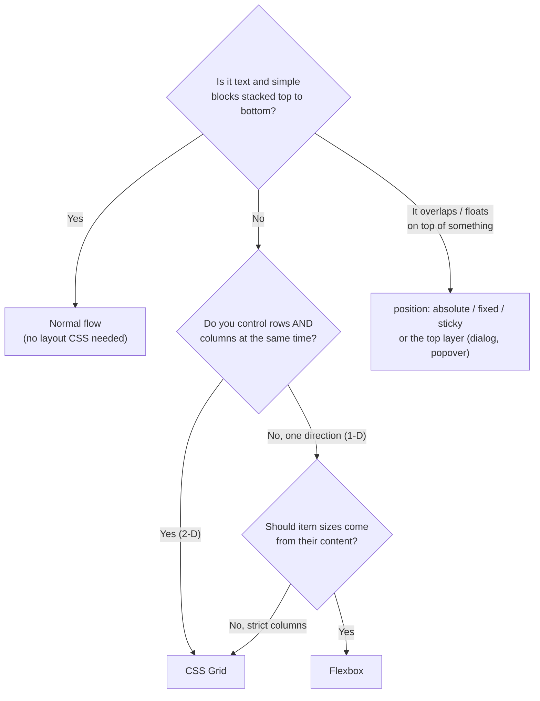

# Layout: Choosing the Right Tool

CSS has four layout systems. Picking the right one is half the job.



| | Flexbox | Grid |
|---|---|---|
| Dimensions | **1-D**: a row *or* a column | **2-D**: rows *and* columns |
| Sizing comes from | **Content outward**: items decide their size, the container distributes leftovers | **Layout inward**: the container defines tracks, items are placed into them |
| Great for | Navbars, toolbars, button groups, centering, media objects, tag lists | Page layouts, card grids, dashboards, forms, galleries, overlapping elements |
| Wrapping | Each wrapped line is independent (items in row 2 don't align with row 1) | Items align to columns across every row |

!!! tip "The honest rule of thumb"
    Use **Grid** for the overall page and for anything that should line up in columns. Use **Flexbox** for components *inside* that grid, and whenever you'd say "put these things in a row and space them out". Most real UIs nest both.

## The same UI, two ways

```css
/* A row of 3 equal cards */
.flex { display: flex; gap: 1rem; }
.flex > * { flex: 1; }

.grid { display: grid; grid-template-columns: repeat(3, 1fr); gap: 1rem; }
```

<div class="demo">
<p style="margin:0 0 .3em"><strong>flex</strong></p>
<div class="c" style="display:flex"><div class="b" style="flex:1">Short</div><div class="b" style="flex:1">A much longer item that wraps</div><div class="b" style="flex:1">Mid</div></div>
<p style="margin:.8em 0 .3em"><strong>grid</strong></p>
<div class="c" style="display:grid;grid-template-columns:repeat(3,1fr)"><div class="b">Short</div><div class="b">A much longer item that wraps</div><div class="b">Mid</div></div>
</div>

They look the same here. The difference shows up when they **wrap**:

<div class="demo">
<p style="margin:0 0 .3em"><strong>flex-wrap</strong>: the last row stretches, columns don't line up</p>
<div class="c" style="display:flex;flex-wrap:wrap"><div class="b" style="flex:1 1 140px">1</div><div class="b" style="flex:1 1 140px">2</div><div class="b" style="flex:1 1 140px">3</div><div class="b" style="flex:1 1 140px">4</div><div class="b" style="flex:1 1 140px">5</div></div>
<p style="margin:.8em 0 .3em"><strong>grid auto-fill</strong>: every item stays in a column</p>
<div class="c" style="display:grid;grid-template-columns:repeat(auto-fill,minmax(140px,1fr))"><div class="b">1</div><div class="b">2</div><div class="b">3</div><div class="b">4</div><div class="b">5</div></div>
</div>

## Pages in this section

- [Flexbox (complete)](flexbox.md): every property, with live output
- [CSS Grid (complete)](grid.md): every property, with live output
- [Responsive Design](responsive.md): mobile-first, media and container queries, fluid everything
- [Layout Patterns](patterns.md): 17 real-world layouts with code
- [Latest UI Trends](ui-trends.md): bento, glass, dark mode, micro-interactions, and how to build them
