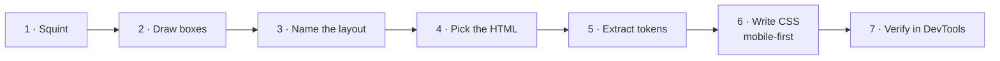

# Reverse Engineering a UI

The rest of this playbook goes **code → output**. This section goes the other way: **you see a design (a screenshot, a Figma file, a website) → you write the code.** That's the actual day-to-day job.

## The 7-step method <span class="lvl lvl-1">Beginner</span> { #the-7-step-method data-toc-label="The 7-step method" }



### 1. Squint

Blur your eyes (or literally blur the screenshot). Ignore text and icons. What are the **big regions**? Usually: header, hero, a few content bands, footer.

### 2. Draw boxes

Draw a rectangle around every group of things that move together. Then draw rectangles inside those. You end up with a tree of boxes: that's your DOM structure.

<div class="demo">
<div style="display:grid;gap:6px;font:600 12px system-ui;color:#222">
  <div style="border:2px solid #e4572e;padding:6px;border-radius:6px;display:flex;gap:6px;align-items:center">header
    <span style="border:2px dashed #3f51b5;padding:2px 6px">logo</span>
    <span style="border:2px dashed #3f51b5;padding:2px 6px;margin-left:auto">nav · nav · nav</span>
    <span style="border:2px dashed #3f51b5;padding:2px 6px">button</span></div>
  <div style="border:2px solid #e4572e;padding:6px;border-radius:6px;display:grid;grid-template-columns:1fr 1fr;gap:6px">hero
    <span style="border:2px dashed #3f51b5;padding:14px 6px">h1 + p + buttons</span>
    <span style="border:2px dashed #3f51b5;padding:14px 6px">image</span></div>
  <div style="border:2px solid #e4572e;padding:6px;border-radius:6px;display:grid;grid-template-columns:repeat(3,1fr);gap:6px">features
    <span style="border:2px dashed #3f51b5;padding:10px 6px">card</span><span style="border:2px dashed #3f51b5;padding:10px 6px">card</span><span style="border:2px dashed #3f51b5;padding:10px 6px">card</span></div>
</div>
</div>

### 3. Name the layout of each box

For each box, ask: **"Are its children in a row, a column, a grid, or stacked on top of each other?"**

| You see | Use |
|---|---|
| Children stacked vertically, full width | Normal flow (nothing) or `flex-direction: column` + `gap` |
| Children in one row, spaced out | `display: flex` + `gap` / `justify-content` |
| Children in rows **and** columns that line up | `display: grid` |
| A row that wraps into more rows | `grid` with `auto-fit` (aligned) or `flex-wrap` (not aligned) |
| Something on top of something else | `grid-area: 1/1` stacking, or `position: absolute` |
| Something that stays put when scrolling | `position: sticky` / `fixed` |
| Something that floats above the page | `<dialog>` / `popover` |

### 4. Pick the HTML for each box

Ask "what **is** this?", not "what does it look like?"

| Looks like | Probably is |
|---|---|
| Top bar with logo and links | `<header>` + `<nav>` + `<ul>` |
| Clickable thing that goes somewhere | `<a href>` |
| Clickable thing that does something | `<button>` |
| A card with title, text, image | `<article>` with a heading |
| A row of tabs | `role="tablist"` buttons, or links if each tab is a URL |
| Expand/collapse | `<details>` / `<summary>` |
| Popup that blocks the page | `<dialog>` |
| Small floating menu | `[popover]` |
| Rows of data with headers | `<table>` |
| Steps 1-2-3 | `<ol>` |

### 5. Extract the design tokens

Before writing any component CSS, collect the repeating values:

- **Colours**: brand, text, muted text, background, surface, border, success/warning/error.
- **Type scale**: usually 5–7 sizes. Measure heading and body sizes; look for a ratio (1.2, 1.25, 1.333).
- **Spacing scale**: most designs use a 4px or 8px grid (4, 8, 12, 16, 24, 32, 48, 64).
- **Radii**, **shadows**, **breakpoints**.

```css
:root {
  --c-brand: #e4572e; --c-text: #1f2329; --c-muted: #6b7280; --c-surface: #f6f7f9; --c-border: #e5e7eb;
  --fs-sm: .875rem; --fs-base: 1rem; --fs-lg: 1.25rem; --fs-xl: 1.75rem; --fs-2xl: 2.5rem;
  --sp-1: 4px; --sp-2: 8px; --sp-3: 12px; --sp-4: 16px; --sp-6: 24px; --sp-8: 32px; --sp-12: 48px;
  --radius: 12px; --shadow: 0 4px 16px rgb(0 0 0 / .08);
}
```

### 6. Write CSS, mobile-first

Start with the narrowest layout (usually everything stacked), then add `min-width` queries or container queries for wider layouts. See [Responsive Design](../layout/responsive.md).

### 7. Verify in DevTools

| DevTools feature | What it tells you |
|---|---|
| **Elements → hover a node** | The element's box, padding (green) and margin (orange) |
| **`flex` / `grid` badges** in Elements | Click to overlay the flex/grid lines, gaps, area names and line numbers |
| **Computed** tab | The final value of every property and which rule set it |
| **Styles** tab (crossed-out rules) | Which rule lost the cascade, and why |
| **Layout** panel | All grid/flex containers on the page with overlay toggles |
| **Device mode** (++ctrl+shift+m++) | Test any screen size |
| **Rendering → Emulate** | `prefers-color-scheme`, `prefers-reduced-motion`, vision deficiencies |
| **CSS Overview** panel | Every colour, font and media query used on a page: instant token extraction from any website |
| **Lighthouse / Accessibility tree** | Contrast failures, missing labels, landmark structure |

!!! tip "Reverse-engineering someone else's site · 🟡 Intermediate"
    1. Right-click → **Inspect** on the element you like.
    2. Check its `display` in **Computed** to see if it's flex or grid, then turn on the overlay.
    3. Open the **CSS Overview** panel to export their colours and fonts.
    4. Rebuild it yourself from scratch. Don't copy their CSS; it's usually tangled with their framework. Copy the **idea**.

## Practice

1. Pick any recipe in [See This → Write This](recipes.md). Read only the "You see" line and the Output box.
2. Write the code yourself.
3. Compare with the given code.

Then open the [Layout Gallery](gallery.md), screenshot one section, and rebuild it without looking.
